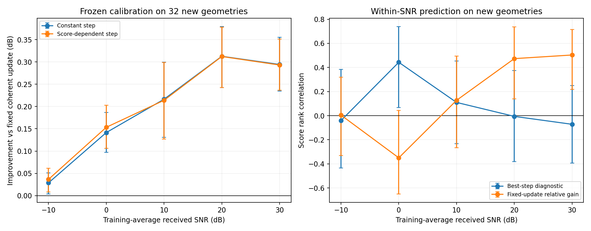

# 时延分数标定：主要增量来自统一步长，额外分数收益集中于0 dB

2026-10-28，运行 `coherent_calibration_20261028_v1` 已完成。**在32个新几何上，训练/验证冻结的常数步长比原固定相干更新改善0.029–0.313 dB，五点配对95%区间均为正。加入现有时延分数后，0 dB额外改善0.01184 dB，其余四点相对常数标定的区间覆盖零。**

本轮标定输出修正步长lambda，内部相干先验rho始终为0.95。结果支持当前完整CSI目标下原输出修正幅度偏小，尚未建立该单分数在五SNR下的广泛额外标定收益。

## 设计与冻结

沿用4×256阵元、4RF、J=32、K=32、30 GHz的已冻结DMA采集配置、物理观测与功率标定。使用原512训练几何中的前32个产生标定标签，白化噪声种子2026102803；原512训练归一化保持原样。标定器的分数变换统计、线性系数仅由这32训练几何拟合；原相干缓存的32验证几何只选择岭正则。

所有系数及源码先冻结，随后生成32个新筛选几何，seed=2026102804，与全部已知训练、验证和历史筛选几何无交集。五SNR共享几何和标准噪声，不当作160个独立样本。两个标定器使用相同训练标签及验证条件；在线共用同一自由/相干后验与分数。

每场景完整CSI平方误差除以自身真值能量，在线性尺度平均再转dB；区间按32几何配对bootstrap2000次，seed=2026102805，各SNR共享抽样索引。[预声明与公式](../../docs/guides/COHERENT_CALIBRATION.md) · [冻结记录](frozen.json)。

## 1. 新几何上的实际结果

| SNR/dB | 自由后验NMSE/dB | 固定相干NMSE/dB | 常数标定NMSE/dB | 分数标定NMSE/dB | 常数比固定改善/dB及95%区间 |
|---:|---:|---:|---:|---:|---|
| −10 | −2.824 | −3.172 | −3.200 | −3.208 | 0.02867 [0.00368, 0.05111] |
| 0 | −10.855 | −11.437 | −11.578 | −11.590 | 0.14149 [0.09711, 0.18681] |
| 10 | −18.970 | −19.823 | −20.039 | −20.037 | 0.21633 [0.13063, 0.29943] |
| 20 | −27.502 | −28.393 | −28.706 | −28.705 | 0.31269 [0.24258, 0.37906] |
| 30 | −36.215 | −36.983 | −37.278 | −37.277 | 0.29433 [0.23481, 0.35549] |

固定相干相对自由后验在五点也均有正增益及正区间。常数标定的步长分别为1.290、1.658、1.832、1.851、1.993，全部从训练拟合并经验证选择正则，没有使用新几何调步长。

| SNR/dB | 分数标定比常数标定改善/dB | 配对95%区间/dB | 改善场景数/32 |
|---:|---:|---|---:|
| −10 | 0.00784 | [−0.00241, 0.01632] | 16 |
| 0 | 0.01184 | [0.00450, 0.01967] | 24 |
| 10 | −0.00237 | [−0.00669, 0.00222] | 20 |
| 20 | −0.00044 | [−0.00125, 0.00027] | 16 |
| 30 | −0.00124 | [−0.00493, 0.00279] | 14 |

0 dB的额外收益约对应平均线性NMSE再下降0.27%。其他点保留正负点估计，当前最稳定且更大的增量来自常数幅度标定。

## 2. 为什么原方向有用，步长仍有可调空间

记 $r=H-\widehat H_{free}$、$d=\widehat H_{coh}-\widehat H_{free}$，输出为

$$
\widehat H(\lambda)=\widehat H_{free}+\lambda d.
$$

每个场景的归一化误差随lambda为

$$
E_i(\lambda)=E_i(0)-2\lambda b_i+\lambda^2c_i,\qquad
b_i=\frac{\operatorname{Re}\langle r_i,d_i\rangle}{\lVert H_i\rVert^2},\quad
c_i=\frac{\lVert d_i\rVert^2}{\lVert H_i\rVert^2}.
$$

固定方向、使用公共步长且无岭正则时，训练最优点为 $\lambda=\sum_i b_i/\sum_i c_i$。这取决于误差抵消与修正能量之比。前轮已观察到方向对齐，本轮训练得到大于1的步长，独立新几何又验证了增加该方向幅度的收益。当前输出目标下，lambda=1没有充分利用已有修正方向。

这一结果涉及输出修正。内部相关块的rho保持0.95，gamma与时延模型也保持原推断；本轮没有重估它们。

## 3. 时延分数究竟预测了什么

使用的分数为 $s=\sum_{g\in\mathcal C}\gamma_gm_g/\sum_g\gamma_g$，即保留的相干分量占总原子方差的份额。它已经通过时延权重参与相干后验。本轮检验它是否还能提供额外步长信息。

分数与两个诊断目标的逐SNR Spearman秩相关如下；最佳步长诊断为事后 $b_i/c_i$，真值只用于评分和诊断：

| SNR/dB | 分数与最佳步长的秩相关及95%区间 | 分数与固定更新相对收益的秩相关及95%区间 |
|---:|---|---|
| −10 | −0.040 [−0.435, 0.384] | 0.005 [−0.330, 0.320] |
| 0 | 0.443 [0.068, 0.738] | −0.350 [−0.650, 0.043] |
| 10 | 0.110 [−0.233, 0.453] | 0.127 [−0.266, 0.495] |
| 20 | −0.006 [−0.380, 0.374] | 0.473 [0.140, 0.736] |
| 30 | −0.071 [−0.392, 0.249] | 0.503 [0.218, 0.714] |

0 dB下，分数确实包含最佳步长的信息，与该点小幅额外标定收益相符。20/30 dB下，分数能排序已有固定更新的收益，但对还应增大多少步长的信息很弱。二者的目标不同：固定收益是 $2b_i-c_i$ 相对原误差的比例，最佳步长是 $b_i/c_i$。

为解释这种差异，另用保存结果作事后诊断：20/30 dB时，分数与相对修正能量 $c_i/E_i(0)$ 的秩相关分别为0.422、0.499，区间为[0.102,0.654]、[0.221,0.690]。分数较大时，已有更新往往也已经更强。0 dB该相关为−0.548，区间[−0.782,−0.197]，其步长信息呈现不同关系。这支持分别按SNR检查，数据没有给出统一的“分数高就继续加大修正”规则。

分数线性标定的训练斜率为−0.149、0.215、0.071、−0.012、−0.080；30 dB新几何中31.25%的条件步长到达预设上界2，常数步长为1.993。当前结论均针对预先固定的[0,2]步长范围，未读取筛选结果后扩展范围。

## 4. 当前决定与下一候选

本轮保留常数标定作为后续同观测比较的简单参照：其独立新几何增量在五SNR均为正。分数条件标定保留0 dB的小额外收益和其余四点的负/不确定结果，不把分数称为通用的修正可信度。

后续更具体的候选是**用相位模型对未参与估计的观测的预测能力构造可信度**。例如在固定训练/验证几何上，分开估计用的频点与检查用的频点，保持真实逐频DMA算子，观察留出预测误差能否提供额外的步长信息；再与本轮常数参照比较。该方向尚未实施，先保留为讨论候选。本轮未新增特征搜索、扩大步长范围或训练神经网络。

## 运行、续接与核验

累计计算1962.96秒，第一段1017.31秒，第二段945.66秒。初始单段预算1800秒，根据本地实测吞吐，在系数冻结且新观测保存后分段续接，保持全部32筛选几何。没有更改方法、种子或选择结果。原source.zip和frozen保留，续接源码与起始状态另存；独立AST核对确认分数、后验重建、拟合和评价数学函数均未变化。

训练与筛选共320个SBL100输出均未到原0.001一阶阈值，按固定100步保留全部结果。[求解记录](solver_diagnostics.csv)。

独立NumPy重算保存预测，评分最大相对差6.22×10⁻¹⁶；直接独立先验方程重建−10/30 dB首场景自由后验，相对平方差≤6.31×10⁻¹⁶；冻结策略重放与保存输出一致；独立增广最小二乘与原正规方程的系数最大差1.12×10⁻¹⁵。训练统计、验证正则选择、冻结先后及几何隔离检查通过。分析脚本首次对常数策略使用标量索引出错，修正广播后完成核验，原推断输出保持原样。

代码为 `scripts/probe_coherent_calibration.py`，独立重算为本目录 `analyze.py`；输入、训练缓存、完整新预测、源码及续接证据保存在 `runs/coherent_calibration_20261028_v1/`。当前ID已完成；新运行应使用独立ID，`--resume`仅用于已有冻结文件和筛选观测的未完成运行。

[逐场景指标](metrics.csv) · [平均结果](summary.csv) · [配对区间](paired_effects.csv) · [分数关系](score_correlations.csv) · [验证候选](validation.csv) · [独立核验](independent_verification.json) · [冻结](frozen.json) · [任务#6](https://github.com/ConutlessLoneSmokes/DMA_CE/issues/6)。
