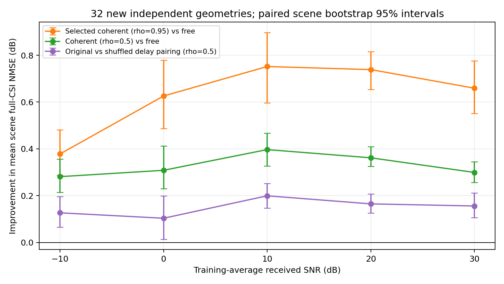
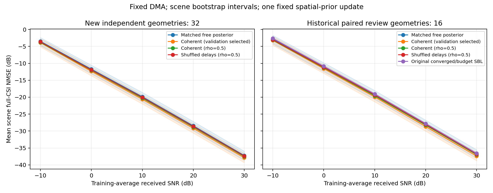

# 相干跨频后验探查：独立新几何上的正增量

2026-10-27完成。运行 `coherent_delay_20261026_v1` 于10月26日启动，计算1049.76秒，未超过1800秒上限。**32个新独立几何上，验证冻结的相干后验在五个SNR点均优于匹配自由后验，mean scene NMSE改善0.378–0.752 dB，描述性配对95%区间均为正。**

这是固定SBL空间方差后增加一次跨频相关更新的探索性证据；真实DMA频响始终由相同的已知矩阵处理，没有估计硬件参数或采用真实路径信息。

## 条件及方法

采集保持原4×256单元、4RF、J=32、K=32、30 GHz带宽及已冻结随机状态库。沿用512训练几何确定的归一化和接收SNR功率标定，参数选择使用原验证集前32几何。随后才生成32个新几何，seed=2026102603；另取旧筛选前16几何作与原充分迭代SBL的同观测配对复核。两队列分开评分，旧队列不称新的独立确认。所有方法在同一条件中共用CSI、观测、噪声与已知矩阵。

每个场景先计算完整复CSI平方误差/真值能量，在线性尺度平均后转dB。SNR是训练平均的白化每复观测接收SNR，不是每个新场景精确达到的SNR。五个SNR共享几何，每队列仍分别只有32和16个独立几何块。区间按场景成块bootstrap2000次，条件于固定状态库、训练统计和验证选择。

原SBL固定100步取得全部角距原子方差及系数统计；保留所有空间原子，较强32个候选才加入相干相关项。每个候选保留两个模时延假设的原权重，其余权重保持独立；没有最强峰LoS判定或三峰路径压缩。低维平滑包络和时延调制构成低秩协方差，逐频边缘方差保持原样，联合后验只使用一次原观测似然。[完整模型及运行前约定](../../docs/guides/COHERENT_DELAY_PROBE.md)。

全部SNR的验证选择均为rho=0.95，这是给定候选集合中的边界选择，不代表全域最优或95%的时延正确率。平均保留的时延权重质量在新队列中从低SNR的0.075增至高SNR的0.460，其余仍为独立分量；权重是经验系数域分数，不是校准概率。

## 新32几何：主要精度结果

“自由参照”是同一SBL100方差、与相干分支匹配双精度计算的逐频独立后验。输出均保存为复单精度，再用复双精度评分。它与原SBL100的差别最多0.00319 dB，明显小于下列相干增量；因此不把计算精度改变归为相干收益。

| 训练平均接收SNR/dB | 自由参照NMSE/dB | 相干后验NMSE/dB | 改善/dB | 改善的配对95%区间/dB |
|---:|---:|---:|---:|---|
| -10 | -3.501 | -3.879 | 0.378 | [0.287, 0.482] |
| 0 | -11.728 | -12.354 | 0.626 | [0.487, 0.778] |
| 10 | -19.866 | -20.618 | 0.752 | [0.597, 0.897] |
| 20 | -28.451 | -29.190 | 0.739 | [0.654, 0.815] |
| 30 | -37.235 | -37.894 | 0.659 | [0.551, 0.777] |

−10 dB有31/32个新场景改善，其余各点32/32改善。30 dB达到−37.894 dB，本轮没有观察到新增的高SNR误差地板。该陈述限本轮五个功率点，不外推到更高SNR或其他信道分布。

## 时延对照支持什么

以下比较统一固定rho=0.5，保持方差、权重、包络及算法流程，只在场景内用预先固定的置换打乱候选时延的对应。它没有为打乱时延对照重新选参。

| SNR/dB | 原估计配对相对自由参照改善/dB | 打乱配对相对自由参照改善/dB | 原配对比打乱额外改善/dB | 额外改善的95%区间/dB |
|---:|---:|---:|---:|---|
| -10 | 0.281 | 0.155 | 0.127 | [0.066, 0.196] |
| 0 | 0.308 | 0.205 | 0.104 | [0.014, 0.200] |
| 10 | 0.397 | 0.197 | 0.199 | [0.147, 0.252] |
| 20 | 0.362 | 0.197 | 0.165 | [0.126, 0.208] |
| 30 | 0.299 | 0.143 | 0.156 | [0.107, 0.211] |

数据估计时延的原配对比打乱配对额外改善0.104–0.199 dB，区间均为正，支持原对应关系有用；这里没有使用真时延。但打乱后仍有约0.143–0.205 dB收益；置换保留了时延集合，可能仍保留共享主径相位结构，也可能存在一般相关收缩作用。本轮不能将全部收益归为准确路径时延。这个分解是在rho=0.5下做的，不能直接作为rho=0.95总收益的比例分解。

两分支使用相同空间表示和固定gamma，因此主要对照测得的是该表示下跨频相关的增量。没有在本轮单独量化保留软空间候选相对硬三峰的贡献，也没有证明恢复了绝对物理时延。

## 旧16几何：与充分迭代SBL的配对复核

原SBL在同一旧观测上的输出直接复用；本轮100步输入重放与原缓存逐值一致。旧队列此前参与研究讨论，只作补充复核，不与新队列合并。

| SNR/dB | 原充分迭代SBL NMSE/dB | 相干后验NMSE/dB | 改善/dB | 配对95%区间/dB |
|---:|---:|---:|---:|---|
| -10 | -2.625 | -3.211 | 0.586 | [0.483, 0.701] |
| 0 | -10.867 | -11.569 | 0.702 | [0.550, 0.868] |
| 10 | -19.073 | -19.921 | 0.848 | [0.719, 0.976] |
| 20 | -27.803 | -28.676 | 0.873 | [0.746, 0.986] |
| 30 | -36.611 | -37.395 | 0.784 | [0.678, 0.879] |

旧队列各SNR的16个场景均改善，配对差为0.586–0.873 dB。原充分SBL共80个输出中，30 dB有1个未达KKT阈值，已保留；其他79个达标。其平均迭代数约1504–4176。新旧两队列共240个SBL100输出均未达原KKT阈值，全部按固定100步报告，不称收敛。

这组相对充分SBL的差距包含输入提前停止的影响：旧队列SBL100本身已改善0.026–0.198 dB，相干分支相对匹配自由后验的新增改善为0.388–0.819 dB。不能将相对充分SBL的全部差距归为相干项；各配对值见[差异表](paired_effects.csv)。

## 表达、计算与实现核验

训练16几何的真空间位置诊断中，自由空间表示NMSE为−56.919 dB，平滑相干表示为−56.909 dB；仅由低维系数包络近似新增的误差为−82.686 dB。这只检查低秩组件的条件表达能力，不代表未知位置可以恢复，也不是实际方法误差下界。真几何没有进入实际候选、时延或强度选择。

本次实现和GPU负载下，共享SBL/系数统计阶段约1.46秒/场景，时延模型约0.01秒，相干后验约0.25秒。共享阶段包含相干分支需要的系数统计；这些值不是与不同运行环境下充分SBL的墙钟速度比较。当前主要代价仍在100步空间SBL，后续效率不能仅用迭代次数宣称。

零相关等价、独立完整复高斯后验/证据、解证书、已知时延及周期等检查通过；91项仓库检查通过。全尺寸短流程v1在重建训练诊断时误用较小抽样总数，导致随机数布局与父缓存不一致，已在正式比较之前修正为先重建原512场景再取子集。v1失败及v2/v3成功完整归档，短流程不用于科学排名。

1280条保存评分独立NumPy重算，最大相对差5.91×10⁻¹⁶；物理MSE重算最大相对差5.00×10⁻¹⁶。对−10/10/30 dB的自由、相干及打乱后验，以独立协方差正向作用核对逆解，最大相对残差2.50×10⁻¹²；恢复CSI与保存值的最大相对平方差6.30×10⁻¹⁶。验证选择、冻结时间、场景隔离和同物理噪声复核通过。[核验](verification.json) · [复算代码](analyze.py) · [求解/权重记录](mechanism_diagnostics.json)。

## 本轮结论及边界

证据支持：在当前真实频变DMA观测和固定空间表示下，不输入真几何的相干跨频系数先验能提供CSI精度增量；估计时延的原候选对应在固定强度对照中进一步有帮助。完整CSI在高SNR继续改善，而20/30 dB的选定后验平均观测残差略有增加，也说明较小观测残差不是本轮增益依据。

本轮新增的是信道系数的跨频相关，真实DMA矩阵对所有方法始终相同。没有单独量化硬件频率选择性相较频率平坦硬件的贡献；也不能只凭这次收益认定DMA专属算法创新成立。相关/块SBL等直接近邻仍需逐式比较。

结论限单个固定DMA状态库、当前同分布几何/噪声条件、32个新几何及一个验证选择。gamma固定，没有联合重估全部空间、时延或gamma；权重不是校准的不确定性。当前均匀频点存在模时延周期，结果不证明绝对时延定位准确或未测频点外推有效。具体后续算法改动尚未采纳。

完整运行约1.23 GB、40个文件已在本地runs/coherent_delay_20261026_v1/与服务器同ID目录保存并逐哈希核对；原父运行保留。三个实施短流程的完整快照也已归档核对。[交付核对](delivery_verification.json)。

[逐场景数据](metrics.csv) · [汇总](summary.csv) · [配对差异](paired_effects.csv) · [冻结选择](frozen.json) · [预声明](../../docs/guides/COHERENT_DELAY_PROBE.md)。
