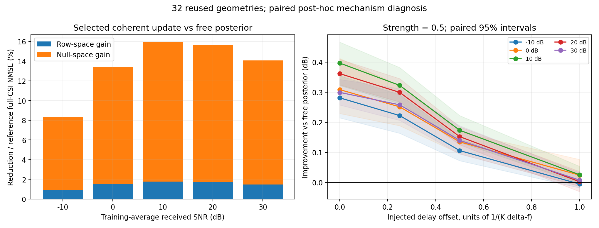

# 相干更新的收益来自哪里，错误相位怎样改变收益

2026-10-28。用户授权的首轮机制研究已完成，主运行 `coherent_mechanism_20261028_v2` 计算472.52秒。**当前相干更新同时改善可观测和未观测方向；主要误差下降位于零空间。固定边缘方差和相关强度后，破坏时延相位会逐步消除收益，去掉时延或偏移一个单位后的收益区间均覆盖零。**

本轮将“错误关联会失败”细化为可观测的结果：在当前软相关强度下，较大的相位失配主要使正收益消失，尚未出现五SNR下稳定的负收益。错误几何硬约束的历史大幅退化另有表示空间证据，两类情况分别解释。

## 数据与控制变量

读取 `coherent_delay_20261026_v1` 保存的实际观测、真值、gamma、时延模型和预测，沿用4×256阵元、4RF、J=32、K=32、30 GHz。每频矩阵为128×1024，32个频点均秩128。32个原新几何与16个历史复核几何分开计算；当前全部属于事后机制诊断，不重新选参。五SNR共享同一组几何。

新增控制仅对32个原新几何计算，固定rho=0.5，保持全部空间方差、逐频边缘方差、32候选、两个时延权重与包络不变。只改变时延：置零，或统一增加0.25/K、0.5/K、1/K的归一化时延。原时延、原打乱配对输出复用，并在每SNR首批重放原后验核对。全部偏移在读取新结果前写入配置，未使用真值改变任何推断参数。

一个偏移单位为 $1/(K\Delta f)=1/B$，约33.33 ps，对应约9.99 mm路程差；½单位约16.67 ps、5.00 mm。这是注入到系数相位的路程等效量，非本轮测得的几何定位误差。

NMSE均为每几何完整CSI平方误差除以自身真值能量，在线性尺度平均后转dB。行空间、零空间、修正和交叉项均使用完整真值能量归一化；区间为2000次几何成块配对bootstrap，种子2026102801。完整条件见[指南](../../docs/guides/COHERENT_MECHANISM.md)。

## 1. 相干更新确实改善了零空间，也改善了行空间

原验证选定rho=0.95，相对同gamma的匹配自由后验：

| SNR/dB | 完整NMSE改善/dB | 行空间自身误差下降/% | 零空间自身误差下降/% | 总线性误差下降中零空间贡献/% |
|---:|---:|---:|---:|---:|
| −10 | 0.378 | 7.09 | 8.53 | 88.87 |
| 0 | 0.626 | 12.06 | 13.62 | 88.61 |
| 10 | 0.752 | 14.41 | 16.10 | 88.89 |
| 20 | 0.739 | 14.23 | 15.83 | 89.11 |
| 30 | 0.659 | 12.63 | 14.27 | 89.54 |

两类误差的配对下降区间在五SNR均为正。原误差本身已有86.91%–88.33%位于零空间，因此两类方向的相对改善更接近；本次效果是完整结构恢复的改善，零空间拥有更大的绝对误差和绝对收益。旧16几何的行、零空间误差也均下降，零空间贡献89.05%–89.70%，单列在原始表中。

设 $r=H-\widehat H_{free}$、$d=\widehat H_{coherent}-\widehat H_{free}$，则收益由

$$
\mathrm{gain}=\frac{2\operatorname{Re}\langle r,d\rangle-\lVert d\rVert^2}{\lVert H\rVert^2}
$$

决定。选定相干修正与真实剩余误差的逐场景实内积余弦均值为0.319–0.416，零空间为0.322–0.418。它提供了方向对齐的直接证据：修正的抵消项超过自身能量代价。比较仍固定原SBL方差，未重新选择空间表示。

## 2. 相位对照把“为什么有用”定位得更具体

下表全部固定rho=0.5，数字为相对自由后验的完整NMSE改善，单位dB，正数表示更好：

| SNR/dB | 原时延 | 打乱配对 | 偏移¼单位 | 偏移½单位 | 偏移1单位 | 时延置零 |
|---:|---:|---:|---:|---:|---:|---:|
| −10 | 0.281 | 0.155 | 0.222 | 0.106 | −0.005 | −0.007 |
| 0 | 0.308 | 0.205 | 0.251 | 0.135 | 0.024 | 0.014 |
| 10 | 0.397 | 0.197 | 0.323 | 0.173 | 0.025 | 0.022 |
| 20 | 0.362 | 0.197 | 0.299 | 0.152 | 0.002 | −0.005 |
| 30 | 0.299 | 0.143 | 0.258 | 0.140 | 0.008 | 0.005 |

原时延、¼和½偏移相对自由后验的区间均为正；1单位偏移和零时延的五点区间均覆盖零。例如10 dB，原时延0.397 dB，偏移½单位0.173 dB，偏移1单位0.025 dB、区间[−0.003,0.054]；零时延0.022 dB、区间[−0.013,0.056]。全部配对区间见[paired_effects.csv](paired_effects.csv)。

可观测机制是：同一路径跨频复系数的相位关系，让某个频点的数据参与其他频点的恢复。纯平滑而不补偿该相位，本轮没有稳定收益；相位偏移逐渐增大时，数据支持的修正方向也逐渐偏离剩余误差。

30 dB的误差恒等式将这一变化量化如下，三项均为平均线性NMSE单位：

| rho=0.5的处理 | 修正能量 | 两倍对齐内积 | 净误差下降 |
|---|---:|---:|---:|
| 原时延 | 5.140×10⁻⁶ | 1.773×10⁻⁵ | 1.259×10⁻⁵ |
| 时延置零 | 1.496×10⁻⁶ | 1.730×10⁻⁶ | 2.339×10⁻⁷ |
| 偏移1单位 | 1.382×10⁻⁶ | 1.714×10⁻⁶ | 3.313×10⁻⁷ |

错误相位下修正能量也变小，但对齐抵消项下降更多，最后只有很小净收益。−10 dB的相同两控制则是抵消项略小于能量项，平均结果轻微退化，配对区间跨零。

## 3. 为什么打乱配对后仍有收益

打乱配对保留了原时延集合，多个空间候选也可能描述相同或相近传播分量。它实际破坏了多少相关结构，可以直接检查，而不必从收益猜测。

本轮计算每个候选的低秩相关核与原核的Frobenius方向余弦，再按保留相关方差加权。五SNR的场景均值为：打乱配对0.580–0.702；¼单位偏移0.813–0.815；½单位0.411–0.416；1单位0.0026–0.0051；零时延0.021–0.025。[逐场景核相似度](kernel_overlap.csv)

因此原打乱对照仍保留相当部分原估计核结构，而注入1单位偏移才近乎去掉这种核的一致性。这解释了两类“错误”控制为何保留不同量级的收益。参照是数据估计核，实际真时延未进入该指标。

解析上，先看单个时延、常数包络的简化核。令 $q_k(u)=e^{-j2\pi ku}$，$C(u)=q(u)q(u)^H$，归一化核重合为

$$
\frac{\langle C(u),C(u+\delta)\rangle_F}{\lVert C(u)\rVert_F\lVert C(u+\delta)\rVert_F}
=\left|\frac{1}{K}\sum_{k=0}^{K-1}e^{-j2\pi k\delta}\right|^2
=\left[\frac{\sin(\pi K\delta)}{K\sin(\pi\delta)}\right]^2.
$$

K=32时，¼、½、1单位偏移的解析值为0.811、0.406、0；实际三维平滑包络和双时延核得到约0.814、0.413、0.004。这个有限几何级数关系为曲线趋势提供了可计算解释。完整CSI收益还经过真实逐频DMA算子和后验求解，核相似度不是其数值预测公式。

## 4. 对“错误关联失败”的修正及后续对象

本次最明确的现象是原相位关系的收益被逐步消除。当前rho=0.5的先验仍保留 $(1-\rho m_g)I$，其中 $0\le m_g\le1$；每候选独立方差至少保留一半，相关块特征值下界至少为0.5。因此错误相位并未把相应系数方向直接删除。

历史三峰几何恢复的主要问题是估计几何限定的表示空间：30 dB时，即使给完整真值拟合共同系数，也只有约−2.025 dB。它将大量空间候选压缩为一套错误的确定几何，和本次仍保留全部原子的软相关控制有实质区别。本轮没有单独改变软/硬空间表示，不将两轮差异归给某一个设计。

当前可以继续研究的具体对象是**相位关系的可信度与相关强度如何匹配**：原相位有用、部分误差仍可容忍、大误差使收益消失，而保留独立分量给当前模型留下调整余地。下一步可先在训练/验证几何上检查经验时延分数能否预测核失配与更新收益，再决定怎样标定或收缩相关项。此项尚未执行，未新增网络训练，也未将扩散设为既定方法。

## 核验、失败记录与复现

主入口的手算复数分解、复数旋转投影和无效输入自检通过；共享控制因子的小尺寸后验与原函数匹配，原函数对应完整复高斯后验、时延周期等4项相关检查通过。实际父评分重算最大相对差6.15×10⁻¹⁶，原rho=0.5重放相对平方差≤7.67×10⁻¹⁶。独立NumPy观测Gram投影与SVD结果在−10/30 dB的首场景最大绝对差2.64×10⁻¹⁶；控制间边缘差≤4.57×10⁻¹⁶。6720条场景/比较/区域分解的恒等式与正交可加性通过。

首次v1完成保存结果的分解后，直接重复全字典双精度推断导致本地显存接近容量、吞吐不足，主动停止；状态、配置、源码与已有分解保留。v2复用相位控制共有的协方差因子并按频点分块，全部对照和输入不变，472.52秒完成。父运行使用文件前后逐哈希一致。新增四组×五SNR×32几何共640个预测已保存，完整运行通过输入哈希引用父归档，无需复制1.23 GB父输入。

运行命令：`python scripts/analyze_coherent_mechanism.py`；独立复算和绘图：`python results/coherent_mechanism_20261028_v2/verify_and_plot.py`。自检用前者的 `--self-check`。当前默认配置ID已经使用，完整重跑应改成独立新ID；结果目录的独立复算可直接重跑。

[完整分解](decomposition.csv) · [分量汇总](summary.csv) · [配对效果](paired_effects.csv) · [核相似度](kernel_overlap.csv) · [运行核验](verification.json) · [独立核验](independent_verification.json)。完整源码、环境与新增预测位于 `runs/coherent_mechanism_20261028_v2/`，任务为[GitHub #5](https://github.com/ConutlessLoneSmokes/DMA_CE/issues/5)。
