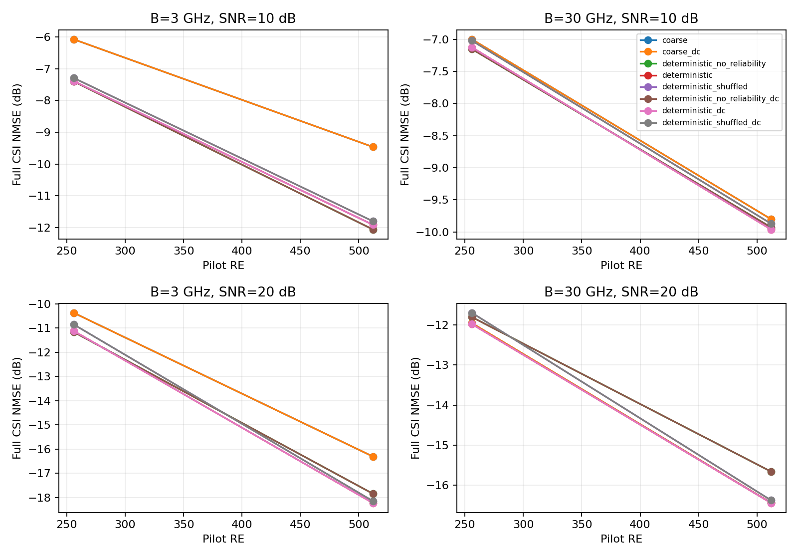
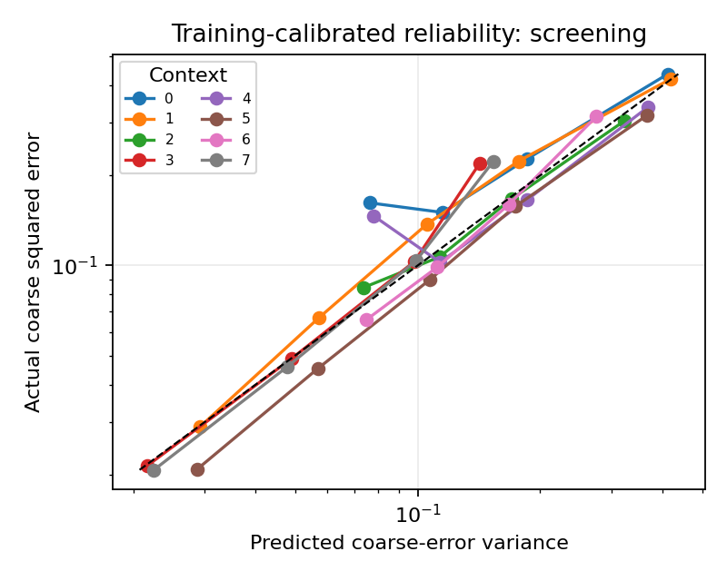

# 第二轮：充分迭代粗估与可靠度对照

归档状态（2026-10-21）：本目录保留历史评分、来源与核验；对应旧缓存已清理。现用完整运行见[清理记录](../../docs/CLEANUP_20261021.md)。

## Material Passport

- Origin Skill: ARS-Codex experiment-agent
- Origin Mode: run
- Origin Date: 2026-10-16
- Verification Status: ANALYZED；数值、来源、划分与模型重放复核通过
- Version Label: deterministic_20261016_v1

充分迭代SBL之后，确定性残差学习仍有收益，主要集中在3 GHz带宽。可靠度会影响模型输出，但相对无可靠度网络的总体净增益较小，并且随条件改变。当前可复现的主要信号是残差精修；可靠度更像在部分高SNR条件下抑制无效修正。

## 固定条件与实际执行

模型仍为单微带单RF、32阵元×32子载波、载频300 GHz，带宽3/30 GHz、配置8/16、训练平均接收SNR为10/20 dB，共8个条件。3径球面波信道的角距连续随机，距离0.1–0.4 m。

训练512、验证64个几何及其观测与第一轮逐项一致；筛选改用独立种子20261017，128个新几何与旧筛选集无交集。数据尺度和可靠度标定由本轮训练粗估重算。核对见[partition_audit.json](partition_audit.json)。

SBL迭代上限由验证集选为1000次，对照2000次时，逐条件NMSE最大变化0.0019 dB、平均后验方差最大变化0.36%，满足[预声明](../../docs/SECOND_STAGE_PLAN.md)。选择过程见[迭代预算报告](../sbl_budget_20261016_v1/report.md)。本轮新筛选1013/1024个场景×条件达到1e-3阈值，比例98.93%。

两套确定性CNN均为15,428个参数、2000次训练更新，使用相同初始化及训练批次。输入为同观测SBL粗估；有可靠度模型另输入标定后的后验对角，无可靠度模型使用同尺寸零占位。打乱组保持网络、初估和物理条件不变，只在该条件的128个场景间置换可靠度。

公共观测一致性系数只按无可靠度模型的验证NMSE，从0、0.1、1、10选择，实际选中0。冻结后全部8条管线的修正输出与原输出相同；以下主表保留4个不同结果，完整8组记录见[summary.csv](summary.csv)。

正式运行763.34秒，共8192条指标。17项数学/物理/控制边界检查通过；逐场景NMSE重算、全部观测哈希、训练标定、源码与模型哈希、保存模型重放均通过，指标和重放最大差异为0，见[audit.json](audit.json)。

## 完整CSI结果

每场景先以真实信道能量归一化误差，再在线性域取平均并转dB；越低越好。“可靠度增量”为有可靠度减无可靠度，负值表示改善。

| 带宽/GHz | 配置数 | SNR/dB | SBL1000 | 无可靠度残差 | 有可靠度残差 | 打乱可靠度 | 可靠度增量/dB |
|---:|---:|---:|---:|---:|---:|---:|---:|
| 3 | 8 | 10 | -6.073 | -7.399 | -7.389 | -7.290 | +0.010 |
| 3 | 8 | 20 | -10.370 | -11.160 | -11.120 | -10.850 | +0.040 |
| 3 | 16 | 10 | -9.460 | -12.057 | -11.909 | -11.798 | +0.148 |
| 3 | 16 | 20 | -16.306 | -17.843 | -18.225 | -18.148 | -0.382 |
| 30 | 8 | 10 | -6.999 | -7.151 | -7.125 | -7.020 | +0.026 |
| 30 | 8 | 20 | -11.952 | -11.801 | -11.977 | -11.695 | -0.176 |
| 30 | 16 | 10 | -9.802 | -9.930 | -9.962 | -9.872 | -0.033 |
| 30 | 16 | 20 | -16.442 | -15.662 | -16.446 | -16.380 | -0.784 |

有可靠度残差相对SBL1000，在3 GHz下改善0.75–2.45 dB；30 GHz下仅改善0.004–0.160 dB。可靠度相对无可靠度网络并非逐条件都更好：8组中4组改善、4组退步；增量最大处为30 GHz、16配置、20 dB，提高0.784 dB。该处SBL为−16.442 dB，无可靠度网络退到−15.662 dB，有可靠度恢复到−16.446 dB，主要效果是避免退化。

## 总体收益与两种统计量

预声明主统计量是线性NMSE均值再转dB。以下把8个条件等权汇总，再以128个独立几何为块计算描述性95%区间。负值表示左侧方法更好。

| 对照 | 线性均值之比/dB | 描述性95%区间/dB |
|---|---:|---|
| deterministic − deterministic_no_reliability | -0.0288 | [-0.0630, +0.0016] |
| deterministic_no_reliability − coarse | -0.7738 | [-0.8521, -0.6968] |
| deterministic − coarse | -0.8026 | [-0.8893, -0.7215] |
| deterministic_shuffled − deterministic | +0.1339 | [+0.0994, +0.1726] |

残差学习本身带来约0.774 dB总体改善；加入可靠度后，总体改善约0.803 dB，额外0.029 dB的区间包含0。按带宽分组，可靠度相对无可靠度在3 GHz下变化+0.024 dB，在30 GHz下变化−0.076 dB，详见[linear_mean_effects.csv](linear_mean_effects.csv)。

原流程同时输出“先逐场景转dB、再计算配对差”的统计量。有可靠度比无可靠度平均改善0.107 dB，区间为[0.074, 0.142] dB；打乱可靠度后平均变差0.130 dB。两种统计量对不同误差大小的权重不同，因此应同时保留，不能用较大的数值替代预声明主统计量。[配对结果](paired_effects.csv)和主统计量均由固定预测计算。

打乱组的误差增加说明模型依赖对应场景的可靠度输入；相对同容量无可靠度网络的净优势仍须单独评价。区间描述当前训练种子和固定置换下的几何差异，未包含重新训练和更换置换的波动。

## 误差来自什么修正

按保存预测分解误差：真实粗估残差r＝H−H粗估，网络修正u＝H估计−H粗估，则平方误差相对粗估的变化为‖u‖²−2Re〈u,r〉。所有项都按真实信道能量归一化。该分解只用于事后评分，恒等式已逐场景核对。

30 GHz、16配置、20 dB时，无可靠度网络新增修正能量0.00736，两倍方向对齐项0.00290，因此净增加误差0.00446。有可靠度后，两项分别为0.00136和0.00138，净变化约−0.000021。此处可靠度主要减小了修正幅度，完整CSI误差回到SBL附近。见[residual_decomposition.csv](residual_decomposition.csv)。

冻结模型在训练和验证集上的事后评分见[split_metrics.csv](split_metrics.csv)。30 GHz、16配置、20 dB时，无可靠度网络在训练集也比SBL差0.615 dB，验证集差0.800 dB；有可靠度网络在两者均接近SBL。宽带收益弱的现象在训练集已存在。

## 下一步待检验的两个因素

一个可检验因素是共同训练损失对不同条件的权重。当前训练集的粗估复MSE从0.0281到0.3424，相差约12倍；网络用统一残差尺度和平方误差训练，高误差条件对总损失贡献更大。可固定全部数据、两套网络、初始化、批次和2000次更新，只把损失改为按各条件训练残差MSE归一化，观察高SNR宽带的过度修正是否减小。若改善，说明损失分配参与了该现象。

另一候选因素是直接对复信道做跨频局部卷积。在保持数据、训练损失及参数量相当的条件下，可比较当前二维卷积与逐频点的一维阵元卷积，分别观察3/30 GHz误差和修正方向对齐项。该对照用于检查跨频处理是否适配宽带相位变化。目前结果未确定两者的相对作用。

## 范围与复现

本轮建立的是缩小系统、单训练种子下的机制筛选结果。完整阵列、多训练种子、更多可靠度置换、扩散训练量和通信性能尚未验证。推断时间为批量均摊：SBL约98–153 ms/样本，CNN精修约0.06–0.11 ms/样本；总计算量仍由粗估主导。

配置、模型/数据哈希、冻结顺序和实际源码快照在本目录；模型、缓存和全部预测保存在本地runs/deterministic_20261016_v1。复核命令为python scripts/audit_experiment.py deterministic_20261016_v1；额外的固定模型评分与线性均值分析可运行本目录[analyze.py](analyze.py)。
