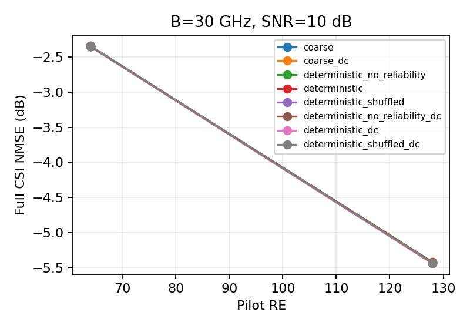
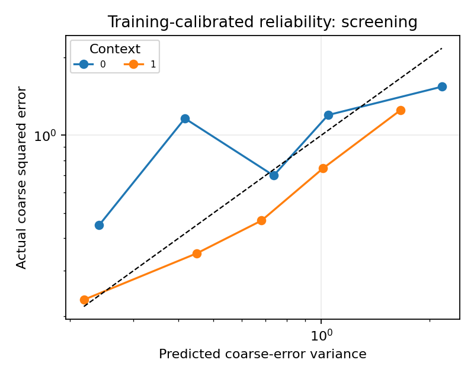

# 确定性残差与可靠度对照

## Material Passport

- Origin Skill: ARS-Codex experiment-agent
- Origin Mode: run
- Origin Date: 2026-10-16
- Verification Status: ANALYZED
- Version Label: deterministic_smoke_20261016_v1

状态：完成。标签：connectivity_deterministic_controls。
独立筛选几何8个，条件2组，逐场景指标128行。
同一几何的条件按块配对；区间仅描述该单训练种子下的几何差异。

| 对照 | 配对平均差/dB | 描述性95%区间/dB |
|---|---:|---|
| deterministic − deterministic_no_reliability | -0.0083 | [-0.0152, -0.0018] |
| deterministic_dc − deterministic_no_reliability_dc | -0.0083 | [-0.0157, -0.0011] |
| deterministic_shuffled − deterministic | 0.0042 | [-0.0018, 0.0089] |
| deterministic_shuffled_dc − deterministic_dc | 0.0042 | [-0.0018, 0.0088] |
| deterministic_no_reliability − coarse | 0.0082 | [-0.0081, 0.0245] |
| deterministic − coarse | -0.0001 | [-0.0184, 0.0186] |
| deterministic_no_reliability_dc − coarse_dc | 0.0082 | [-0.0076, 0.0252] |
| deterministic_dc − coarse_dc | -0.0001 | [-0.0198, 0.0184] |

负值表示左侧方法更好。此表均值是逐场景dB配对差，不等于线性均值再转dB之差。

SBL非收敛比例见summary.csv，逐场景迭代/残差见metrics.csv。后验对角是模型内代理，图中实测误差只用于评分。
计算时间为批量均摊，不是单样本在线时延；该缩小系统不支持完整尺寸或通信净速率结论。
