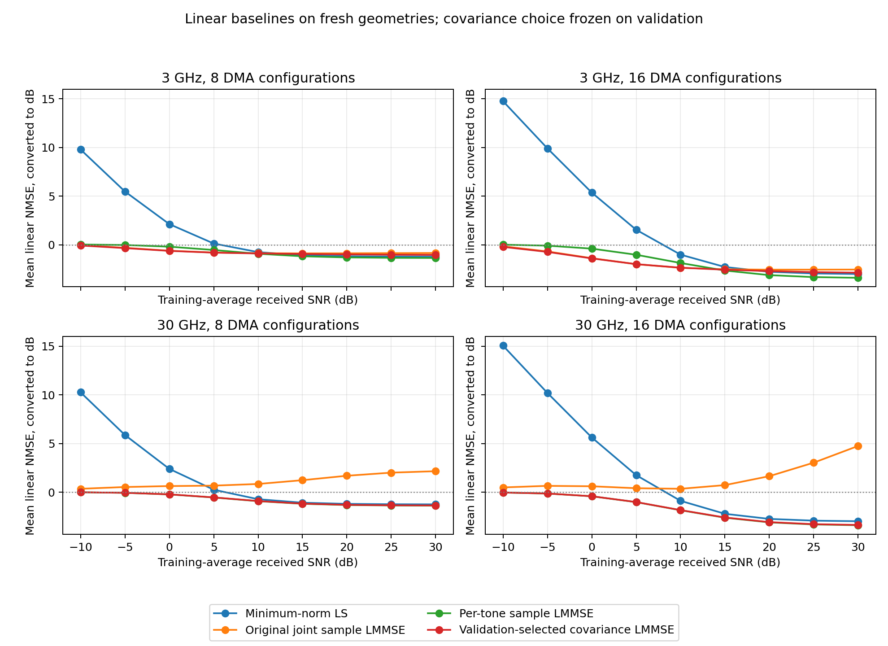
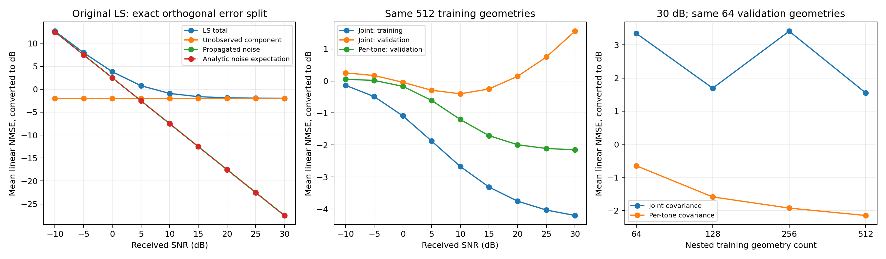

## Material Passport

- Origin Skill: academic-research-suite / experiment-agent
- Origin Mode: validate + run
- Origin Date: 2026-10-21
- Verification Status: VERIFIED
- Version Label: linear_baselines_20261021_v2
- 性质：查看原曲线后设计的实现检查与探索性复查。
- 来源：原SNR运行的512训练几何、64验证几何；首次冻结后另生成256个独立筛选几何，v2精度复核沿用这批预定观测。
- 核验：60项单元检查、小流程、逐场景NMSE重算和LS解析误差分解通过。

# LS与联合LMMSE：异常定位及新基线

LS在低SNR高于0 dB的直接来源是传播到信道估计的噪声误差。高SNR约−2 dB的平台来自未观测维度。联合LMMSE的高SNR回升对应无结构样本协方差对新场景的外推误差；原复数公式与噪声尺度检查通过。

## LS：缺失维度与噪声分开核实

原曲线每个子载波用8或16个复观测恢复32维信道，使用最小范数解 $\widehat h=A^\dagger y$。令 $P=A^\dagger A$，误差为 $-(I-P)h+A^\dagger n$。第一项为未观测分量，第二项为传播后的噪声；两项正交，平方范数严格相加。

原128个筛选几何在0 dB接收SNR下，平均归一化未观测误差为0.631291，噪声项为1.774299，总计2.405589，转dB为3.812 dB。30 dB下噪声项降至0.001774，总误差为−1.986 dB。噪声趋零时的平台为约−1.998 dB。

零估计的NMSE等于1，即0 dB。低SNR的LS噪声项可超过信道能量，因而出现正dB。原曲线10 dB时为−0.922 dB。

本轮新256几何在0 dB下，未观测项为0.626174、实际噪声项为1.989954，解析期望噪声项为1.986314；总计4.177 dB。30 dB总计−2.019 dB，无噪声平台约-2.033 dB。两批场景的差异保持在各自结果中。

SNR按训练几何平均接收功率定义，弱信道的实际SNR更低。主指标对每个几何的归一化误差等权平均；原0 dB的LS若改为误差能量总和除以信道能量总和，将为1.952 dB，低于主指标3.812 dB。本轮保留原评分定义。

四组DMA矩阵的最大条件数为3.190、7.113、5.468和14.431；实测训练噪声功率与设定值之比为0.99950–1.00427。没有观测到噪声方差的倍数错配。LS保留原伪逆定义。

## 联合LMMSE：协方差泛化检查

原函数按标准复数LMMSE公式计算，使用训练样本均值和无偏样本协方差。1024维信道只有512个训练几何，样本协方差秩最多511。代码已与独立构造的完整复数协方差公式对照。

同一512训练几何，在30 dB时联合LMMSE的训练NMSE为−4.199 dB，独立验证NMSE为+1.553 dB；逐频32维协方差的验证NMSE为−2.150 dB。20 dB对应的联合训练/验证为−3.753/+0.147 dB。训练集误差改善没有传递到新场景。

原筛选集在30 dB时，联合LMMSE的行空间误差为0.007784，零空间误差为1.487130；LS的零空间误差为0.631291。主要差距位于需要用统计相关项外推的未观测信道部分。随着噪声方差降低，LMMSE对协方差小特征值方向的抑制减弱；不准确的跨频统计项会产生错误外推。

另一个只使用验证集的对照，固定观测、噪声、64验证几何与求解公式，仅从同一训练集取嵌套子集。下表为30 dB下四硬件条件的线性NMSE平均后转dB：

| 训练几何数 | 无收缩联合/dB | 逐频/dB |
|---:|---:|---:|
| 64 | 3.351 | -0.648 |
| 128 | 1.694 | -1.589 |
| 256 | 3.415 | -1.927 |
| 512 | 1.553 | -2.150 |

逐频估计在该对照中随样本数增加持续改善；联合估计在高SNR不单调。直接增加训练样本数的效果取决于所估计的协方差结构；相同512个样本下，逐频约束已经明显改变结果。

## 已完成的协方差处理

保留训练均值、噪声和所有观测，将联合样本协方差与逐频块对角协方差作凸组合。收缩系数0恢复原联合估计，1等价于逐频估计。验证候选为0、0.1、0.25、0.5、0.75、0.9、1；每个带宽只选一个系数，全部SNR与8/16配置共用。

首次验证冻结3 GHz系数0.1、30 GHz系数0.9后，才生成256个筛选几何。CSI哈希与训练、验证及原SNR筛选集无重叠。原联合统计量在服务器重建后逐元素差为0。

v1的非整数收缩系数存在一次隐式float32掩码乘法。增加0.1/0.9系数的稠密公式回归检查后，v2改为全双精度，并按原候选、原验证规则和预定筛选种子重算。两版观测逐位相同，选择仍为0.1/0.9；逐场景线性NMSE最大变化2.3842e−7，以下三位小数结果不变。[精度修正对照](precision_comparison.json)保存了差值。

高维样本协方差的收缩有既有统计学依据，参见[Ledoit与Wolf原论文](https://www.ledoit.net/Well-conditioned2004.pdf)。本轮系数由验证集选择，目标为逐频块协方差；不使用该论文的系数公式。

## 新256几何的结果

32阵元×32频点，3/30 GHz、8/16配置。下表各值均先在四硬件条件和256几何上平均线性NMSE，再转dB。

| 接收SNR/dB | 最小范数LS/dB | 原联合LMMSE/dB | 逐频LMMSE/dB | 冻结收缩LMMSE/dB |
|---:|---:|---:|---:|---:|
| -10 | 13.123 | 0.178 | 0.006 | -0.075 |
| -5 | 8.400 | 0.091 | -0.071 | -0.302 |
| 0 | 4.177 | -0.098 | -0.301 | -0.636 |
| 5 | 0.988 | -0.294 | -0.766 | -1.044 |
| 10 | -0.835 | -0.333 | -1.359 | -1.446 |
| 15 | -1.617 | -0.115 | -1.841 | -1.744 |
| 20 | -1.897 | 0.333 | -2.106 | -1.919 |
| 25 | -1.990 | 0.957 | -2.215 | -2.004 |
| 30 | -2.019 | 1.778 | -2.253 | -2.039 |

30 dB时，冻结收缩版比原联合版低3.817 dB；逐频版比原联合版低4.031 dB。20 dB时分别低2.252和2.439 dB。逐频版在中高SNR比全SNR共用系数的收缩版更好；20/30 dB差距为0.187/0.214 dB。

全九点汇总，收缩版为−1.185 dB、逐频版−1.120 dB、原联合版+0.329 dB。全SNR汇总与高SNR单点评分的排序不同，逐条件结果均保留。

## 核验和适用范围

- 60项单元检查通过，新增的稠密协方差混合公式与逐频等价检查通过。
- 小流程192条指标重算差0；完整流程36,864条NMSE重算差0。
- 9,216个几何×条件的LS解析误差分解通过，最大差2.85e−14；9,216组观测哈希检查一致。
- 选参后冻结统计量与训练缓存哈希保持不变；服务器原联合统计量重建差0。
- 重新生成36组观测，144次完整预测重放、36,864条五项指标重算、4次选中协方差重建的最大差均为0，见[独立重放审计](replay_audit.json)。
- 服务器原始导出及两个诊断文件共34项逐字节核验通过，见[文件哈希](server_file_hashes.json)。

本轮是固定DMA配置、32×32系统和单组训练/验证几何的探索性结果。256个筛选几何为独立单位，36个条件重复使用相同几何。没有测量在线时延。完整尺寸、新DMA配置及训练数据抽样变化需另行验证。

[实现与冻结规则](../../docs/LINEAR_BASELINES.md) · [逐场景指标](metrics.csv) · [LS误差分解](ls_decomposition.csv) · [验证候选](validation_scores.csv) · [冻结记录](frozen.json) · [核验](audit.json)

[原曲线诊断](../linear_baseline_probe_20261020_v1/contexts.csv) · [样本数对照](../baseline_covariance_probe_20261020_v1/sample_count.csv) · [统计解释检查](statistical_review.json)

统计解释覆盖11/11项，所有比较为描述性结果，未作显著性结论。
