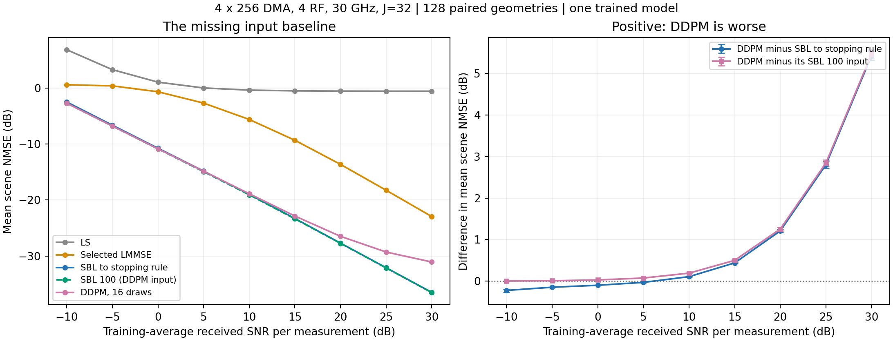

# 多RF正式配置结果分析：2026-10-23

本次分析读取服务器 `/home/lsy/DMA_CE/results/multirf_snr_20261022_v1` 及对应 `runs/` 中已经保存的模型、观测和预测，未重训或重新求解。原始导出按字节复制到 [multirf_snr_20261022_v1](../multirf_snr_20261022_v1/report.md)，本目录独立保存诊断，不改写原运行。

## 主要判断

**当前条件残差DDPM没有改善自己的100步SBL输入。** 九个SNR点的平均NMSE都变差；0 dB及以上每个SNR的128个场景全部变差。低SNR下DDPM稍好于主图中的充分迭代SBL，但100步输入本来已经更好，不能把这个差值归给网络。

大阵列仿真与强结构基线已经建立。下一阶段应先解释生成的无效增量，再讨论学习精修、同精度减少计算或同精度减少导频。可靠度及观测一致性不能作为本轮已经验证的正贡献：可靠度输入全零，验证集在每个SNR均选择关闭末端一致性。

以上是当前冻结模型的探索性结果，适用范围是单组训练几何、单组DMA状态、单次网络初始化、三路径、固定已知仰角30°、无互耦的物理仿真。跨SNR重复的同一几何不是新的独立样本。

## 运行及复核依据

- 配置：300 GHz载频、30 GHz带宽、4条微带×256单元、4RF、32个子载波、J=32。每频128个复观测估计1024维完整CSI，观测/系数比1/8；512训练、64验证、128筛选独立几何。完整条件见[解析配置](../multirf_snr_20261022_v1/config_resolved.json)及[方法指南](../../docs/guides/MULTIRF_SNR.md)。
- 四方法共用物理观测、噪声和DMA状态。LMMSE是512样本的协方差收缩估计；SBL使用193×25角距字典和共享稀疏方差；DDPM还使用同字典100步SBL及干净训练标签，包含16次20步DDIM生成。信息来源相同不等于各方法使用相同先验形式或计算预算。
- 原运行耗时45412.39秒，约12.61小时；训练预算20000步，按验证选择8000步；LMMSE冻结收缩系数0.9，DDPM一致性倍率0。完成状态见[status.json](../multirf_snr_20261022_v1/status.json)，选择见[frozen.json](../multirf_snr_20261022_v1/frozen.json)。
- 复核确认16个本地原始导出与服务器哈希相同；90个源码归档成员和30个冻结文件哈希通过；训练/验证/筛选几何无交集，筛选观测晚于冻结；36个执行及测试源码与本地现有版本一致，正式配置也相同。
- 从已保存张量以complex128重新评分4608行，最大相对NMSE差异为3.035×10⁻⁷；36组汇总与原始1000次几何重采样区间重算差异为0。验证选择重算一致。见[分析汇总](analysis_summary.json)和[缓存复核](cached_diagnostics.json)。这些检查支持评分与归档可信，不等于证明学习方法有效。

主指标先计算每个几何的完整CSI误差能量/真值能量，再在线性尺度平均，最后取10log10。DDPM先对16次复数预测平均，再评分。下表的“充分SBL”指按当前一阶停止条件求解，最多32000步；不表示全局最优或最优CSI误差。

横轴使用训练平均的每复观测白化接收SNR，物理噪声固定，通过已知导频功率改变SNR。白化每频噪声为−84.17 dBm，原RF输出为−69.37至−65.18 dBm；两者对应不同的白化尺度。20/30 dB分别对应总发射导频功率27.09/37.09 dBm，约0.512/5.115 W。30 dB条件下本批筛选几何的实际接收SNR为20.68–38.17 dB，中位数26.12 dB，不是每个场景都恰好30 dB。见[链路预算](../multirf_snr_20261022_v1/link_budgets.csv)及[逐场景统计](diagnostics.csv)。

## 完整结果及缺失的输入基线

| 训练平均接收SNR/dB | LS | 选定LMMSE | 充分SBL | 100步SBL输入 | DDPM16 | DDPM−输入/dB |
|---:|---:|---:|---:|---:|---:|---:|
| −10 | 6.8412 | 0.5808 | −2.4917 | −2.7176 | −2.7149 | +0.0027 |
| −5 | 3.2795 | 0.3843 | −6.6379 | −6.7941 | −6.7845 | +0.0096 |
| 0 | 1.0477 | −0.6698 | −10.7504 | −10.8792 | −10.8500 | +0.0292 |
| 5 | 0.0105 | −2.6919 | −14.8316 | −14.9365 | −14.8618 | +0.0747 |
| 10 | −0.3767 | −5.6146 | −18.9849 | −19.0697 | −18.8772 | +0.1925 |
| 15 | −0.5067 | −9.3293 | −23.2937 | −23.3549 | −22.8548 | +0.5001 |
| 20 | −0.5486 | −13.6333 | −27.6921 | −27.7367 | −26.4824 | +1.2544 |
| 25 | −0.5620 | −18.2516 | −32.0858 | −32.1290 | −29.2840 | +2.8449 |
| 30 | −0.5662 | −22.9499 | −36.4921 | −36.5260 | −31.0652 | +5.4608 |

100步SBL在九个SNR均略优于充分SBL，差距约0.034–0.226 dB。有限迭代与充分优化的CSI误差没有保证的单调关系；当前对照直接说明继续优化边缘似然没有改善这些场景的主指标，尚不能归因于某一种过拟合或正则化机制。

本轮也没有出现“20 dB仍完全不能估计”的普遍现象：20 dB下LMMSE为−13.63、充分SBL为−27.69 dB。旧32单元实验与本轮同时改变了孔径、间距、距离范围、RF数量及压缩比，不能把数值改善单独归因于增加RF链。

LS高SNR平台可以由已有分解解释：其零空间误差/真值能量的几何均值固定约0.877369，对应−0.568 dB；30 dB的总NMSE为−0.566 dB，接近该平台。这是最小范数LS不能从观测行空间补出缺失分量的结果，不构成所有结构恢复方法的误差下界。

## 小差异是否可靠、未收敛是否影响排名

使用10000次配对几何重采样，种子20261023，同一组几何索引用于所有方法及SNR。差值定义为两条mean scene NMSE曲线之差，即均值比的10log10；不是逐场景dB差的平均。以下95%区间均为逐SNR、固定模型条件下的区间，未覆盖重新训练、DMA重抽样，也未作多重比较校正。

| SNR/dB | DDPM−充分SBL及95%区间/dB | DDPM−100步输入及95%区间/dB | DDPM优于输入的场景数/128 |
|---:|---:|---:|---:|
| −10 | −0.2232 [−0.2756, −0.1895] | +0.0027 [0.0021, 0.0034] | 33 |
| −5 | −0.1466 [−0.1525, −0.1408] | +0.0096 [0.0083, 0.0109] | 6 |
| 0 | −0.0995 [−0.1042, −0.0950] | +0.0292 [0.0272, 0.0311] | 0 |
| 10 | +0.1077 [0.1001, 0.1154] | +0.1925 [0.1851, 0.2002] | 0 |
| 20 | +1.2097 [1.1694, 1.2506] | +1.2544 [1.2129, 1.2969] | 0 |
| 30 | +5.4269 [5.3178, 5.5400] | +5.4608 [5.3521, 5.5738] | 0 |

低SNR相对充分SBL的差异在这组固定模型/硬件下可复现，但其来源已被输入对照区分。−10 dB的网络增量虽区间不含0，量级仅0.003 dB，不宜包装为有实际意义的退化。中高SNR则有明显的不利增量。

充分SBL的迭代中位数约1488–1707步。30 dB有8/128个达到32000步预算却未达KKT阈值，其余SNR全部达标；8个失败保留于主结果。仅作描述性敏感性分析，同时排除这8个配对场景后，DDPM−充分SBL为+5.4261 dB，几乎等于全样本+5.4269 dB。因此这8个输出不能解释主要差距。完整字段见[diagnostics.csv](diagnostics.csv)。

## 无效修正怎样形成高SNR误差

令$H$为真值、$H_{100}$为输入，$D=H_{\mathrm{DDPM}}-H_{100}$为生成修正，$R=H-H_{100}$为实际待修正残差。每个场景恒有

$$
\frac{\lVert H_{\mathrm{DDPM}}-H\rVert^2}{\lVert H\rVert^2}
=\frac{\lVert R\rVert^2}{\lVert H\rVert^2}
+\frac{\lVert D\rVert^2}{\lVert H\rVert^2}
-\frac{2\operatorname{Re}\langle R,D\rangle}{\lVert H\rVert^2}.
$$

已保存输出给出了以下直接观察：

- 九个SNR的归一化修正能量均值约5.60–5.73×10⁻⁴，几乎不随SNR增大而减小；修正方向与真实残差的实内积余弦均值仅约−0.00044至0.00615。
- 30 dB下，输入NMSE均值约2.2254×10⁻⁴；加入修正能量约5.6022×10⁻⁴，交叉项只抵消约2.6662×10⁻⁷，最后得到约7.8249×10⁻⁴。修正没有沿真实残差有效抵消，反而成为误差的主要部分。
- 30 dB下，约87.6%的新增误差位于$A_k$的零空间。对当前一次标量Gaussian校正，其增量形如$A_k^H M_k(y_k-A_k\widehat h_k)$，属于观测行空间，因而不能改变现有零空间误差。不能用更小观测残差代替完整CSI改善，也不能由此否定所有交替学习/物理更新方法。

这些是对该冻结预测的误差分解，不是对“随机方差”或“生成均值偏差”的唯一归因。仅保存16次平均，无法分开两者；也不能凭近零平均余弦就证明修正完全独立或各向同性。

训练数据提供一个值得检验的线索：100步粗估的训练复残差MSE从−10 dB的0.4155降到30 dB的1.639×10⁻⁴，相差约2535倍；本轮却统一使用0.19355的实残差尺度，没有显式SNR输入。它可能造成不同条件下的尺度适配难度，但扩散噪声损失并不等于CSI残差MSE，当前证据不能直接断言低SNR主导了训练损失。

## 冻结与三个候选机制的状态

| 环节 | 本轮事实 | 当前能够下的判断 |
|---|---|---|
| 同观测残差生成 | 100步输入经DDPM后九点平均变差；验证集平均输入NMSE为0.096046，选定DDPM为0.096574 | 本轮没有精修增益，验证集已有同方向证据；不能继续只与充分SBL比较 |
| 可靠度条件 | 可靠度通道为零 | 本轮没有检验可靠度增益；历史小系统的微弱收益不能直接转移 |
| 真实观测一致性 | 0/0.1/1/10中每个验证SNR均选0 | 当前这一次标量校正没有收益；不是所有物理更新的否定结论 |
| 训练长度 | 验证8000步优于20000步 | 本轮追加至20000步没有改善选定目标；不能直接宣布普遍过拟合或以“没训够”解释全部结果 |

本轮的`metrics.csv`将DDPM的网络调用数和精修时间记录为0，这是共享评分接口的占位值。实际配置有16×20次网络评估，外加100步SBL；不能用占位值比较方法速度。未来若以计算量为目标，需补齐包含粗估、字典/矩阵准备、生成和同步的测时。

## 研究进展与下一步讨论

已有研究完成了候选A筛选、可靠度消融、SBL求解纠偏、物理传播/固定热噪声预算、LS与样本LMMSE异常分解、观测数扫描及1024单元多RF迁移。其证据说明结构恢复有效、学习增量需要更严格的直接输入对照；尚未建立“可靠度条件扩散加观测一致性稳定优于强基线”的主张。[完整研究进程与原始文献依据](../../docs/research/RESEARCH_PROGRESS_20261023.md)保留历史结论与各阶段限制。

以下是待讨论方案，没有据此启动实验：

1. **固定模型区分生成均值偏差与有限采样方差。** 保持8000步断点、同一训练/验证输入和20步采样日程，重复初始噪声并比较1/4/16/64次平均。若额外误差近似随1/M消失，支持有限平均的方差解释；若均值稳定后仍偏离真实残差，继续增加平均不能解决。只有确定仍有学习空间，才增加同输入、同容量的确定性残差对照，再分别检验显式SNR或训练标定尺度，避免把多个改动合并归因。
2. **同精度减少计算。** 以100步SBL和充分SBL同时为参照，先量出较少迭代的精度—时间曲线，再决定需要何种学习或连续参数修正。现在没有明显高SNR平台，不能预设离网格误差已经是主瓶颈。已有[OG-DOLS原文](https://arxiv.org/html/2407.04954v1#S4.SS3)包含连续角距修正，单纯加入该步骤并非新贡献，宽带适配与公平先验需要另行说明。
3. **同精度减少导频。** 固定恢复器，研究更少DMA状态及符合真实共享调谐频响的状态选择。J从32减半会将发送RE从1024降到512；固定每观测SNR与固定总能量是不同对照，必须分别声明。已有[LISTA-SMO原文](https://arxiv.org/html/2311.08158v1#S3.SS2)联合学习观测及恢复，本项目的可能问题应具体到全带共享谐振控制和物理预算，不能仅以“联合优化”作为新意。

新模型的选参继续只用训练/验证几何；当前筛选集已参与方向讨论，未来确认性评价应另用新几何。不同网络初始化和DMA状态的稳定性也需单独评估，而不能由本次几何区间代替。

## 复算材料

[cached_diagnostics.py](cached_diagnostics.py)在服务器现有环境中以CPU读取原运行张量，标准输出保存为`cached_diagnostics.json`；[analyze.py](analyze.py)从仓库根目录读取原始导出及该诊断，重算汇总、配对区间并绘图。所有新分支/循环均有针对本次数据完整性、选择和分解恒等式的断言。

本次分析在服务器既有Python 3.10/PyTorch 2.11/NumPy 1.26.4/Matplotlib 3.10.8环境运行，临时输出使用`/tmp/dma-ce-multirf-review-20261023-01a16135/`，复制回本目录并核对哈希后已清理该临时目录。未修改服务器项目、运行缓存或正式配置。原始结果文件哈希及分析环境见[analysis_summary.json](analysis_summary.json)。
