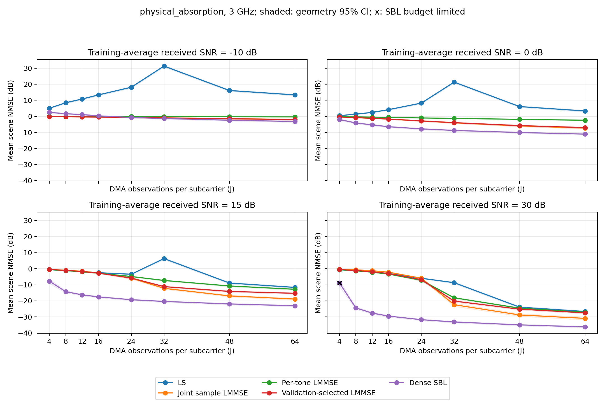
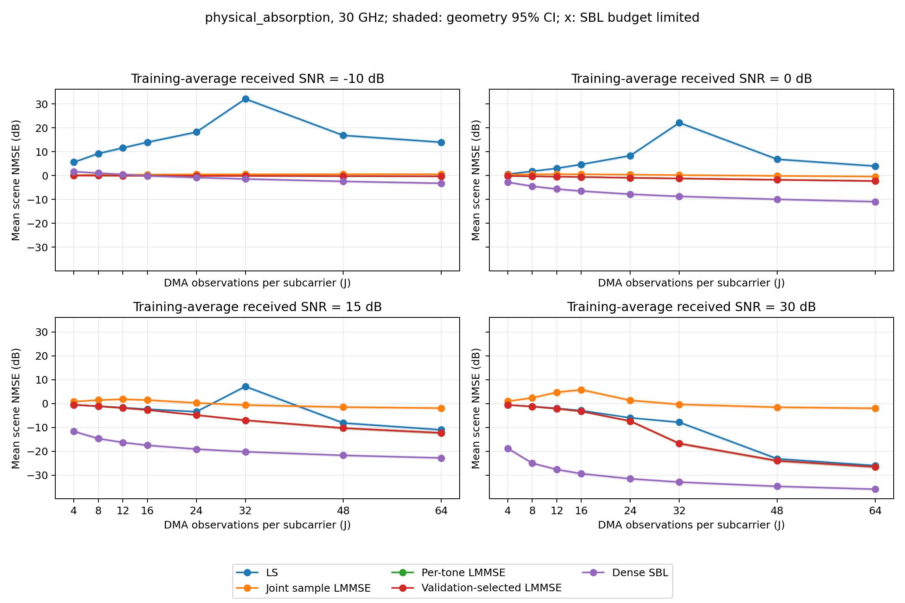

# DMA观测数扫描：结果核验与解释

2026-10-22。对应已完成的 `observation_baselines_20261022_3ghz_v1` 和 `observation_baselines_20261022_30ghz_v1`。本次读取冻结缓存、观测和预测，进行指标复算、线性公式重放和解析诊断；未重新运行SBL或选择参数。

## 核心判断

SBL的平均完整CSI误差在两个带宽、四个SNR下都随观测数增加而下降；0、15、30 dB的全部观测点均优于本轮四条线性基线。−10 dB的小观测区间则是LMMSE更稳，不能把SBL概括为所有条件下最优。

LS在J=32附近的误差峰值有明确的矩阵证据：观测方程虽然满秩，弱奇异值仍造成严重噪声放大。30 GHz联合样本LMMSE的高SNR退化也有直接证据：有限训练信道张成的子空间遗漏了新场景的重要分量，给当前估计器造成约−3.58 dB的NMSE下限。两种异常机制不同。

## 条件和核验范围

300 GHz载频，32阵元、32子载波、单RF链；3 GHz和30 GHz带宽分别运行。每子载波观测数J为4/8/12/16/24/32/48/64，目标训练平均接收SNR为−10/0/15/30 dB。物理信道含一条直达、两条反射路径，沿用既有传播、吸收、DMA和热噪声模型。

512个训练几何、64个验证几何、128个独立筛选几何。训练尺度和统计量先冻结，再生成筛选观测。同一几何跨J、SNR和带宽配对；两带宽使用同一DMA调谐序列。五种方法在每个条件下使用相同观测、矩阵及已知噪声方差。SBL额外利用97×13角距球面波字典与跨频共享稀疏结构，LMMSE利用训练集均值和协方差；真路径位置未提供给估计器。

两个运行均为complete，分别耗时7352.16和4856.70秒。40960条指标来自128个独立筛选几何在64个条件下的五种方法，不能将条件重复当成新增独立样本。

独立核验已覆盖全部保存预测：以复双精度重新计算NMSE和物理MSE，NMSE最大相对差为4.45×10⁻⁷，MSE一致；LS独立重放最大相对预测差为2.56×10⁻⁸。另用训练样本空间的对偶线性方程，在两个带宽的J=16/64、30 dB条件重现联合LMMSE，最大相对差2.54×10⁻⁸。训练SNR复算最大差4.58×10⁻⁷ dB。

已检查训练/验证/筛选无几何重叠、两带宽几何及状态配对、冻结缓存和源码归档哈希、观测与预测绑定关系、嵌套噪声前缀，以及所有频点的矩阵秩。核验详见 `verification.json`；这是实现和记录一致性的证据，不能替代跨训练种子的科学重复。

## J=64的完整CSI NMSE

每个场景先除以自身真值能量，再对128个场景在线性尺度平均，最后取10log10。下表单位均为dB，越小越好。

| 带宽/GHz | 接收SNR/dB | LS | 联合LMMSE | 逐频LMMSE | 冻结收缩LMMSE | 密SBL |
|---:|---:|---:|---:|---:|---:|---:|
| 3 | −10 | 13.351 | −1.947 | −0.323 | −1.971 | −3.205 |
| 3 | 0 | 3.351 | −7.305 | −2.423 | −7.002 | −11.056 |
| 3 | 15 | −11.649 | −18.905 | −12.808 | −15.324 | −23.076 |
| 3 | 30 | −26.649 | −30.914 | −27.096 | −27.476 | −36.232 |
| 30 | −10 | 13.959 | 0.539 | −0.315 | −0.315 | −3.245 |
| 30 | 0 | 3.959 | −0.410 | −2.285 | −2.285 | −10.953 |
| 30 | 15 | −11.041 | −1.933 | −12.316 | −12.316 | −22.814 |
| 30 | 30 | −26.041 | −2.026 | −26.563 | −26.563 | −35.914 |

30 dB、J=64时，SBL相对该点表现最好的线性方法，3 GHz改善5.32 dB，30 GHz改善9.35 dB。按相同几何配对重采样5000次，差值的描述性95%区间分别为[−6.01, −4.64]、[−9.51, −9.19] dB。区间只覆盖固定训练集和DMA状态下的筛选几何变化。

物理MSE也在全部八条SBL曲线上随J下降，主要趋势没有依赖逐场景NMSE归一化才出现。物理MSE是每个复信道系数的平均平方误差；其单位不是dBm。完整数值见 `j64_results.csv` 及原始 `summary.csv`。

## LS：满秩仍可能严重放大噪声

J<32时，每频点有32个未知数，最小范数LS存在未观测分量。J≥32后，本次所有频点均满列秩，未观测误差降至数值精度；但J=32的弱奇异值很小。

| 带宽/GHz | J | 最差频点条件数 | 15 dB时LS NMSE/dB |
|---:|---:|---:|---:|
| 3 | 24 | 20.60 | −3.453 |
| 3 | 32 | 202.01 | 6.299 |
| 3 | 48 | 15.64 | −8.926 |
| 3 | 64 | 10.31 | −11.649 |
| 30 | 24 | 23.05 | −3.441 |
| 30 | 32 | 536.48 | 7.131 |
| 30 | 48 | 25.50 | −8.179 |
| 30 | 64 | 18.32 | −11.041 |

将白化观测写成 $y_k=A_kh_k+n_k$，复噪声协方差为 $\sigma^2I$。最小范数LS的误差为

$$
\widehat h_k-h_k=-(I-A_k^\dagger A_k)h_k+A_k^\dagger n_k.
$$

右侧两项分别属于零空间和行空间，彼此正交，因此平方误差可直接分解。固定信道后的期望噪声能量为 $\sigma^2\sum_k\lVert A_k^\dagger\rVert_F^2$，小奇异值通过其倒数平方放大噪声。

例如3 GHz、15 dB时，J=24的线性NMSE为0.247608未观测误差加0.203935噪声误差，合计0.451543，即−3.453 dB。J=32时未观测项消失，但噪声项达到4.265246，即+6.299 dB；J=64时噪声项降至0.068413，即−11.649 dB。保存观测的直接分解重现了曲线峰值，未发现伪逆求解或指标汇总错误。

这些结果支持在当前状态序列下使用更多冗余观测改善LS，而不支持“观测数量刚好等于未知数就能稳定估计”。它们也不保证其他DMA调谐序列在同一个J处出现相同峰值。矩阵与误差分解见 `hardware.csv`、`ls_decomposition.csv`。

## 联合样本LMMSE：30 GHz的训练子空间缺失

联合方法把32频点×32阵元的信道向量化为1024维，用512个训练信道估计完整协方差。设训练均值为 $\widehat\mu$，中心化训练信道张成子空间为 $\mathcal S$。其维数本次为511。样本协方差的像空间包含于 $\mathcal S$，因此当前联合LMMSE的所有输出满足

$$
\widehat h\in\widehat\mu+\mathcal S.
$$

即使观测矩阵已经满列秩、噪声继续减小，这个由固定训练协方差施加的约束仍然存在。对筛选真值做最优投影，可得当前估计器无法低于的平均NMSE：

$$
\mathbb E_g\left[\frac{\lVert P_{\mathcal S^\perp}(h_g-\widehat\mu)\rVert^2}{\lVert h_g\rVert^2}\right].
$$

这里用真值仅计算诊断下限，没有把投影结果提供给任何估计器。

| 带宽/GHz | 训练协方差有效秩 | 训练仿射子空间外的平均相对误差 | 换算dB | J=64、30 dB实测联合LMMSE |
|---:|---:|---:|---:|---:|
| 3 | 63.35 | 6.994×10⁻⁸ | −71.55 | −30.91 |
| 30 | 208.69 | 0.438612 | −3.579 | −2.026 |

有效秩定义为 $(\sum_i\lambda_i)^2/\sum_i\lambda_i^2$，反映样本能量分布，不等于精确矩阵秩。两带宽的精确样本秩都是511，但30 GHz的能量分散在更多方向，新场景在已学子空间以外的残差明显更大。

这个下限已经说明：固定当前联合样本协方差时，仅增加J无法将30 GHz的NMSE推到−10或−20 dB。实测−2.026 dB还高于投影下限，因此缺失方向之外，有限噪声和子空间内的统计误差也仍有影响，不能把全部差距都归入秩不足。

另一个针对性诊断是固定已学估计器，对噪声解析取平均。30 GHz、30 dB时，J=16在训练场景上的期望NMSE为−14.64 dB，在筛选场景上为+5.77 dB；J=64分别为−30.69和−2.03 dB。此处没有重新训练或增加噪声试验，数值由固定线性增益的偏差与噪声方差直接计算。它与保存预测一致，支持有限样本统计量的泛化限制，不能用测试场景来自不同生成分布来替代这一解释。

逐频LMMSE分别估计32维空间协方差，避免了同一个511维联合子空间约束。它在30 GHz、J=64、30 dB达到−26.56 dB，也说明该条件的物理观测本身足以支持高精度恢复。诊断见 `training_subspace.csv`、`joint_linear_risk.csv`。

## 收缩版本和SBL的解释边界

冻结收缩系数在3 GHz为0.1，在30 GHz为1。后者直接对应逐频协方差，所以30 GHz的红线和绿线重合是正确结果。系数针对验证集全部J/SNR的平均线性NMSE选择，一个带宽共用一个值；它不保证每个高SNR点都优于联合或逐频方法。3 GHz、J=64、30 dB时，冻结收缩版为−27.48 dB，弱于联合版−30.91 dB，属于这一全条件选择目标的实际代价。

−10 dB时，3 GHz的J=24处SBL与冻结LMMSE差值为+0.045 dB，配对95%区间[−0.236, +0.304]，尚不能稳定区分。J=32处差值−0.377 dB，区间[−0.638, −0.146]。30 GHz的J=16差值−0.067 dB，区间[−0.426, +0.265]；J=24处差值−0.692 dB，区间[−1.096, −0.324]。这些是固定训练和硬件条件下的描述性区间，未做多重比较校正。完整配对表见 `paired_effects.csv`。

SBL共8192个输出，其中8191个达到记录的一阶阈值。唯一未达阈值者位于3 GHz、J=4、30 dB、场景65：32000次更新后KKT残差0.001162，NMSE−1.375 dB。原始结果保留此样本；仅作为敏感性诊断临时排除时，该点均值从−8.891变成−9.053 dB，差0.162 dB。

该条件的SBL中位数为−17.02 dB，但存在5个NMSE高于0 dB的场景，其中均已达到记录阈值。整体误差的99.86%位于观测矩阵零空间。这里的小观测条件存在恢复困难，不能仅归因于一个未收敛样本；当前记录仍不能区分稀疏解释的歧义、模型/网格近似与局部驻点的影响。一阶判停也不证明找到了全局最优解。本次核验读取已有KKT记录，未重新运行SBL求解器。

3 GHz的J=4→8在30 dB下使SBL从−8.89改善到−24.41 dB，收益很大；J=32→64只从−33.15改善到−36.23 dB。更多观测有收益，但边际收益与原始恢复难度有关。30 GHz的J=4优于3 GHz，尚不能将差异单独归因为频率多样性，因为带宽同时改变了信道相位和DMA响应。

## 代价、文件口径与下一步

这组曲线固定训练平均每观测接收SNR，天线与接收机物理噪声不变，通过已知导频功率校准SNR。增加J也增加导频时间和总能量。30 dB时，从J=4到64，3 GHz有效导频能量增加约15.43倍，30 GHz增加约15.71倍。因此不能据此宣称固定总导频能量下也有相同收益；跨带宽比较也同时改变了符号时长。逐场景实际SNR仍随几何变化，不是每个场景都恰好处于标称值。

原始 `summary.csv` 中 `nmse_linear_ci95_low/high` 字段实际保存的是dB区间；图中与 `mean_nmse_db` 配合使用，绘图数值正确，但字段名称容易误读。本次保留冻结导出；派生 `paired_effects.csv` 的区间列已明确使用 `_db`。两带宽的NMSE和MSE图均已检查。

最有针对性的后续对照是固定30 GHz的观测和筛选场景，只增加独立训练几何并重算联合协方差，同时检查子空间投影下限和独立评价误差。这样可以直接验证训练覆盖的改善，不必重新扫描SBL。该建议尚未执行，也没有据筛选结果重新调参。

本轮仍是缩小系统、单组训练/验证抽样与单组DMA状态下的探索性比较。所有区间不含训练集、硬件状态或模型重新抽样的不确定性；传播和噪声假设沿用 `docs/PHYSICAL_MODEL.md`。

## 图表

