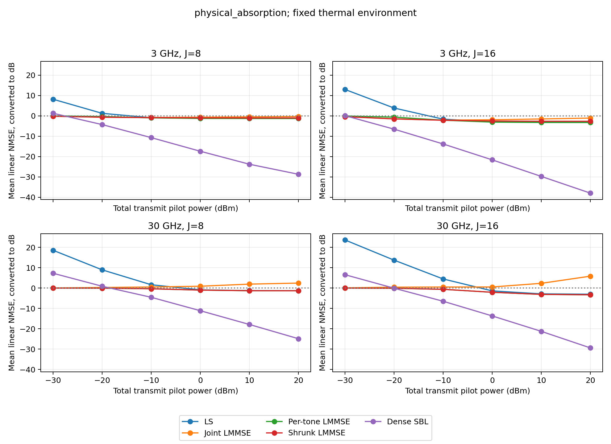

# 固定热噪声与物理THz路径：模型修正及方法影响

2026-10-21正式运行与独立核验已完成。物理路径模型没有消除LS正NMSE和联合LMMSE高功率变差；在当前短距离条件下，单独加入吸收对功率汇总NMSE的影响不超过0.0013 dB。相同发射功率下模型的接收SNR不同，不能把结果变化归于扫描写法。

[完整三模型数值表](report.md) · [逐场景指标](metrics.csv) · [配对差异及区间](paired_effects.csv) · [物理链路预算](link_budgets.csv)

## 模型修正的含义

原实现已经包含自由空间扩散损耗和球面传播相位，额外使用独立复高斯路径系数，并关闭了分子吸收。复高斯路径系数描述随机衰落，与接收端加性白噪声是两个不同对象。本轮依据所给论文式(11)、(18)--(21)改用一个直达路径及两个单次反射路径：振幅包含总传播距离的自由空间损耗、分子吸收、Fresnel反射及表面粗糙度衰减，不再额外乘独立Rayleigh衰落系数。随机几何及传播相位仍使信道具有随机性。

固定热环境下，接收物理噪声不随发射功率改变。经典热噪声功率为$k_BT B$，压力通过气体吸收等过程影响传播，不是该式的额外乘数。接收机使用$T_e=T_0(10^{NF/10}-1)$计算附加噪声，经过DMA输出噪声白化后，每频点物理方差为$N_a=k_BT_aB/K$。依据见Rohde & Schwarz的[技术说明](https://scdn.rohde-schwarz.com/ur/pws/dl_downloads/dl_application/application_notes/1sl378/1SL378_0e_ColdSrcNF.pdf)第7--11页。

算法输入除以已知每频点导频幅度$\sqrt p$和训练尺度$s$，其有效方差因而为$N_a/(ps^2)$。这个方差随功率变化是单位换算的结果。相同信道、观测算子及有效SNR下，归一化噪声扫描与功率扫描等价；修改扫描写法本身不会自动改善NMSE。本轮增加了绝对链路预算，并在统一预算下比较传播模型。

传播细节、来源哈希及假设见[物理模型说明](../../docs/PHYSICAL_MODEL.md)。论文原件保留于用户文献库，匹配所给PDF的哈希记录见[来源核对](paper_source_verification.json)。本轮不复现论文144阵元AoSA及18米场景。

## 实验口径

300 GHz载频，32阵元、32频点、单微带单RF链，3/30 GHz带宽，8/16个DMA配置，三个传播路径，距离0.1--0.4米。每个模型使用512个训练、64个验证及128个独立筛选几何；三模型共用几何、DMA状态、基础物理噪声与功率。归一化及LMMSE统计量仅用训练数据，协方差收缩强度仅用验证数据选择，全部冻结后才生成筛选观测。

功率为每个OFDM导频符号的全带总功率。配置数从8增至16时，导频时间与总能量也增加；它不是固定总导频能量比较。每个功率点包含四种硬件条件，以下先按每个完整CSI计算能量归一化误差，在线性域等权平均后转dB。同一几何下的多个条件保持配对，不能当成独立样本。

天线温度296 K，参考温度290 K，接收机NF=6 dB；15 dBi接收增益与88微米表面粗糙度取自论文设置，常实数折射率1.5为声明的材料假设。所有方法在各模型内使用同一观测和噪声信息，不读取真实路径。

## 含吸收物理模型的五方法结果

| 总发射功率/dBm | LS | 联合LMMSE | 逐频LMMSE | 收缩LMMSE | 密SBL |
|---:|---:|---:|---:|---:|---:|
| -30 | 19.171 | -0.067 | -0.022 | -0.156 | 4.864 |
| -20 | 9.455 | -0.284 | -0.267 | -0.529 | -1.528 |
| -10 | 1.588 | -0.336 | -0.963 | -0.938 | -7.537 |
| 0 | -1.528 | -0.149 | -1.777 | -1.595 | -14.394 |
| 10 | -2.009 | 0.859 | -2.134 | -1.932 | -21.386 |
| 20 | -2.060 | 2.627 | -2.194 | -1.990 | -28.304 |

数值单位为NMSE/dB。0 dBm并不表示0 dB接收SNR：本物理模型在3 GHz的训练平均接收SNR约20.8 dB，在30 GHz约10.6 dB。更宽带宽的总热噪声更大，等功率合并结果不能解释为统一接收SNR的结果。

密SBL在中高功率明显优于线性方法；最低功率时却为正NMSE，弱于收缩LMMSE。这些不利结果保留，不能仅展示高功率结果来宣称全范围优势。一阶条件达标也不保证真实CSI误差最小。

另见[随机增益对照曲线](gaussian_free_space/power_nmse.png)及[物理无吸收曲线](physical_free_space/power_nmse.png)。30 GHz的逐频与收缩LMMSE重合，是验证集选择了完全逐频的收缩强度1.0。

## 传播模型的配对影响

0 dBm发射功率下，三模型的NMSE为：

| 传播模型 | LS | 联合LMMSE | 逐频LMMSE | 收缩LMMSE | 密SBL |
|---|---:|---:|---:|---:|---:|
| 原随机增益，自由空间 | -1.799 | -0.052 | -2.023 | -1.864 | -15.539 |
| 物理路径，无吸收 | -1.528 | -0.149 | -1.777 | -1.596 | -14.395 |
| 物理路径，含吸收 | -1.528 | -0.149 | -1.777 | -1.595 | -14.394 |

三组均使用新热噪声预算、相同15 dBi接收增益、观测及功率口径。原随机增益组0 dBm时的训练平均接收SNR约为25.5/15.1 dB，对应3/30 GHz；物理无吸收组约20.8/10.6 dB，低约4.5--4.7 dB。因此，这里测量的是固定发射功率下更换传播模型的合并效果，包含总路程、反射衰减、去除随机路径系数及相应统计量变化，不是某一因素的独立因果效应。

物理无吸收相对随机增益组，在0 dBm时密SBL变差1.144 dB，按128个几何块配对重采样的95%区间为[0.445, 1.801] dB。联合LMMSE的均值变化为-0.097 dB，区间[-0.392, 0.201] dB，不能据此确认稳定改善。

20 dBm时密SBL的均值从-27.335变为-28.305 dB，变化-0.970 dB，但区间[-2.653, 0.623] dB包含0。本轮只支持平均值更好，尚不能确认该改善稳定。该点的LS与三种LMMSE组间差异区间也均包含0。

物理含吸收相对物理无吸收的对照只改变吸收。各方法、各功率点的汇总NMSE变化绝对值最大为0.001267 dB；SBL为0.000640--0.000955 dB。在当前频段、距离和既有吸收表下，吸收的数值影响很小。此结论不外推至更长距离或吸收峰附近。

## LS超过0 dB的原因

把频点堆叠后，对已白化并除去导频的观测$y=Ah+n$，最小范数LS为$\hat h=A^\dagger y$。令$P_A=A^\dagger A$为观测行空间的正交投影，则

$$
\hat h-h=-(I-P_A)h+A^\dagger n.
$$

第一项是观测无法确定的CSI分量，第二项是LS拟合并经伪逆放大的噪声，两项正交。无噪声时误差不超过真值能量，加入噪声后总误差可以超过真值能量。0 dB对应零输出基线，不是估计误差的上限。

对本轮含吸收组的128个筛选几何和四种硬件条件，固定同一配对噪声时，实际LS曲线近似为

$$
\overline{\mathrm{NMSE}}_{LS}(P_{dBm})
=0.621425+0.0819993\,10^{-P_{dBm}/10}.
$$

这里功率以0 dBm为参照，两个系数来自本轮数据，不是普适常数。0 dBm时线性误差约0.7034，转为-1.528 dB；-20 dBm时噪声项增至约8.20，总误差约8.82，转为+9.455 dB。更换为物理路径模型没有消除该机制。

| 带宽 | 配置数 | 不可观测能量比例 | 0 dBm时拟合噪声的线性NMSE |
|---|---:|---:|---:|
| 3 GHz | 8 | 0.746918 | 0.005762 |
| 3 GHz | 16 | 0.492582 | 0.019234 |
| 30 GHz | 8 | 0.748033 | 0.071302 |
| 30 GHz | 16 | 0.498166 | 0.231700 |

增加配置数降低了不可观测能量，同时使本组DMA矩阵的LS噪声拟合项变大。因此，高功率时增加配置有利，低功率时收益可能被噪声放大抵消，不能仅通过增加观测数保证LS低于0 dB。

## 联合LMMSE问题是否随物理修正消失

没有。在含吸收模型的20 dBm条件下，联合LMMSE在验证集为+2.119 dB，筛选集为+2.627 dB；逐频版分别为-2.224与-2.194 dB。问题在验证集已经出现，不能仅归于筛选集特有的分布变化。

联合版使用512份训练CSI估计1024维复信道的跨频点相关性，中心化样本协方差秩至多511；逐频版每次处理32维空间统计量。这个维度与样本数关系没有因更换路径模型而改变。结合原有[协方差诊断](../baseline_covariance_probe_20261020_v1/report.md)，有限样本的高维统计估计仍是需要处理的问题；本轮没有增加物理模型的训练样本，不能把旧模型的样本数实验当成本模型的验证结果。

## 完成状态与核验

每模型24种条件，每条件128个几何，每几何五方法各估计一次，合计9216组观测与46080份输出，独立筛选几何数为128。密字典97×13，最多32000次更新，一阶阈值1e-3；9216次SBL均达到阈值。主流程状态为[complete](status.json)。

[独立重算](independent_audit.json)使用双精度重新计算全部NMSE，最大相对差4.14e-7；LS和三种LMMSE预测重放的最大相对差1.08e-11；LS偏差与噪声正交分解的最大相对误差6.22e-8。训练尺度、冻结时间、几何划分、物理噪声与源代码/输入哈希也均通过核对。[LS误差预算](ls_error_budget.csv)和[SBL停止记录](solver_audit.csv)保存逐条件数据。

[实现检查](implementation_verification.json)记录69项数学与实现检查通过及小流程结果。v1缓存中的NumPy标量阻止安全恢复，已停止并用v2修复，未据此调整科学参数或筛选场景。两个GPU补算使用同一冻结求解函数；一次CPU补算尝试因低吞吐停止，未发布任何估计输出。各辅助脚本、来源哈希及运行事件保留。本轮不比较在线时延，线性方法耗时字段的0是占位值。

完整训练缓存、观测及预测保存在服务器`/home/lsy/DMA_CE/runs/physical_baselines_20261021_v2/`；本目录保留配置、环境、源码快照、逐场景表、图及审计。旧运行未被覆盖。

## 适用范围

吸收表缺少温度、压力、湿度及HITRAN版本元数据，不能声称已精确恢复论文296 K、1 atm、1%水汽条件的吸收谱。300 GHz处表内系数约$9.5612\times10^{-4}$ m$^{-1}$，0.4米吸收损耗约0.00166 dB，结论限于当前频段和短距离。

本轮属于单种子缩小系统探索；配对重采样仅覆盖固定训练数据下的筛选几何变化，不覆盖重新抽取训练集的波动。没有重训神经网络，也没有验证完整尺寸、通信闭环或实测DMA参数。
