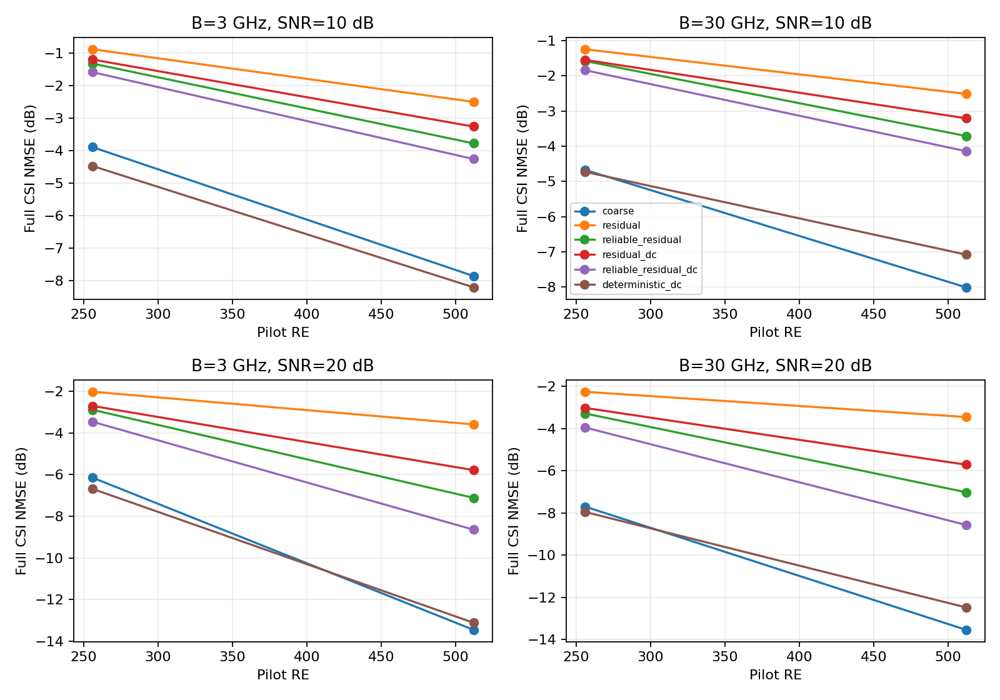
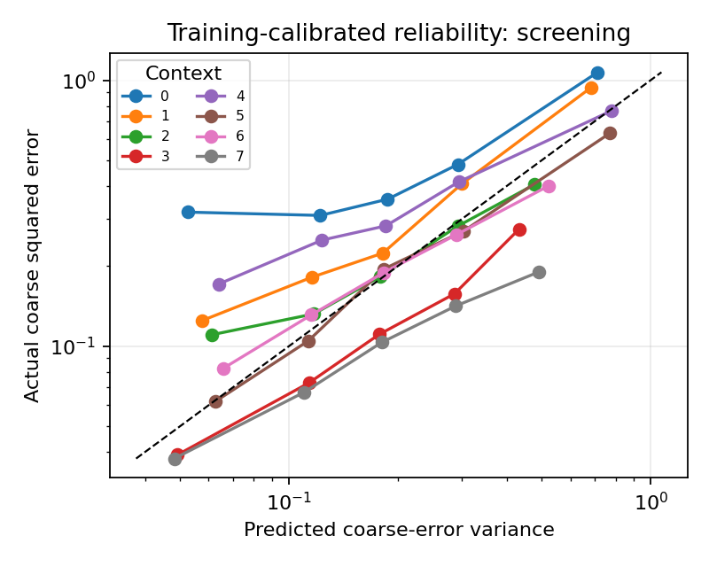

# 候选A首轮筛选与诊断

归档状态（2026-10-21）：本目录保留历史评分、来源与核验；对应旧缓存已清理。现用完整运行见[清理记录](../../docs/CLEANUP_20261021.md)。

## Material Passport

- Origin Skill: ARS-Codex experiment-agent
- Origin Mode: run
- Origin Date: 2026-10-16
- Verification Status: ANALYZED；数值、来源和重放复核通过
- Version Label: pilot_20261016_v1

当前实现的可靠度条件残差扩散没有超过同观测SBL。可靠度改善了扩散方法内部的对照，但单次生成引入的误差仍明显大于有用修正；确定性残差网络的改善主要集中在3 GHz带宽。

## 实验设置与复核

单微带、单RF、32阵元和32子载波，载频300 GHz；带宽3/30 GHz，配置数8/16，训练平均白化接收SNR为10/20 dB。配置数对应256/512个导频RE。每个配置的同一组谐振控制状态决定全部频点响应。球面波3径信道采用连续随机角距，距离0.1–0.4 m，阵列Rayleigh距离约0.48 m。该轮未计入分子吸收。

训练/验证/筛选分别有512/64/128个独立几何场景，同一几何在8个条件间配对。全局信道尺度、残差尺度与可靠度标定均由训练集确定。SBL采用49角度×7距离字典、跨频共享方差，首轮预算100次迭代。四个网络均为15,428个参数、2,000次训练更新；扩散训练100级噪声、推断20次网络调用。

共享观测一致性系数仅由无可靠度残差模型的验证结果选择，取1.0；模型及系数在筛选前冻结。该一致性步骤采用真实频变DMA矩阵和已知噪声方差。

主实验用时207.11秒，共8×128×11＝11,264条逐场景指标。13项数学与物理检查通过；独立复核重算了全部NMSE和观测哈希，检查几何划分、训练标定常数、冻结顺序、源码/模型哈希，并重放一批保存模型。指标和重放最大差异均为0，详见[audit.json](audit.json)。

## 完整CSI结果

表中NMSE先逐场景按真实信道能量归一化，再在线性域取平均并转为dB，越低越好。DC表示末端观测一致性修正。确定性残差网络也输入可靠度。

| 带宽/GHz | 配置数 | SNR/dB | SBL | 无可靠度残差扩散+DC | 可靠度残差扩散+DC | 确定性残差 | 确定性残差+DC |
|---:|---:|---:|---:|---:|---:|---:|---:|
| 3 | 8 | 10 | -3.89 | -1.19 | -1.58 | -4.65 | -4.47 |
| 3 | 8 | 20 | -6.15 | -2.70 | -3.46 | -6.65 | -6.68 |
| 3 | 16 | 10 | -7.85 | -3.25 | -4.25 | -9.51 | -8.20 |
| 3 | 16 | 20 | -13.46 | -5.78 | -8.65 | -14.78 | -13.12 |
| 30 | 8 | 10 | -4.67 | -1.55 | -1.84 | -4.93 | -4.73 |
| 30 | 8 | 20 | -7.70 | -3.02 | -3.95 | -7.96 | -7.95 |
| 30 | 16 | 10 | -8.01 | -3.21 | -4.14 | -8.12 | -7.08 |
| 30 | 16 | 20 | -13.53 | -5.71 | -8.57 | -13.56 | -12.47 |

可靠度残差扩散+DC在全部8个条件下仍比SBL差2.31–4.97 dB。确定性残差相对SBL的点估计改善为：3 GHz下0.50–1.66 dB，30 GHz下0.02–0.26 dB。当前没有无可靠度确定性网络，尚不能把确定性网络的收益归因于可靠度。

共享DC系数根据扩散模型选择，对确定性网络在多组条件下反而增加完整CSI误差。因此不能仅凭观测残差变小选择一致性强度。所有开关结果保存在[summary.csv](summary.csv)。

## 可靠度与误差来源

| 对照：左减右 | 逐几何配对平均差/dB | 描述性95%区间/dB |
|---|---:|---|
| reliable_residual − residual | -0.8376 | [-1.0172, -0.6600] |
| reliable_residual_dc − residual_dc | -0.6769 | [-0.8301, -0.5219] |
| reliable_residual_shuffled − reliable_residual | 0.2217 | [-0.0614, 0.4990] |
| reliable_residual_shuffled_dc − reliable_residual_dc | 0.2100 | [-0.0085, 0.4371] |
| deterministic_dc − reliable_residual_dc | -3.7456 | [-3.8700, -3.6314] |

负值表示左侧更好。该表先计算逐场景dB差，再对同一几何的8个条件取平均；区间按128个独立几何块bootstrap。它与上表的线性均值转dB是不同统计量。区间只描述这个训练种子下的几何差异。

打乱可靠度时，配对平均误差增加约0.21 dB，区间包含0。局部可靠度信息的独立收益还不稳定。全局标定也未消除条件差异：例如3 GHz、8配置、10 dB的最低方差组，预测复误差方差约0.053，实际为0.319；具体分组见[calibration.csv](calibration.csv)。

为定位生成误差，对保存预测作事后分解。令真实残差为r＝H−H粗估，模型修正为u＝H估计−H粗估，则总平方误差相对粗估的变化为‖u‖²−2Re〈u,r〉。使用筛选真值只计算该评分诊断。可靠度残差扩散在8组条件中新增的归一化修正能量为0.153–0.352，而两倍方向对齐项仅为−0.00145至0.01383，新增能量没有被有效抵消。逐组数据见[residual_decomposition.csv](residual_decomposition.csv)，可由复核脚本重算。

在30 GHz、16配置、20 dB时，可靠度残差扩散的归一化零空间误差为0.1045，SBL为0.0261。零空间指DMA观测矩阵无法观测的信道分量。DC将生成结果的行空间误差从0.0943降至0.0347，但零空间误差保持0.1045，因此观测修正无法消除这部分新增误差。

## 验证集补充诊断

主结果冻结后，另对验证集固定前32个几何、全部8个条件做两项控制实验：[诊断报告](../validation_probe_20261016_v1/report.md)。只改变SBL迭代上限，100→500次改善1.64–4.45 dB，达到阈值的比例从4/256增至159/256。主筛选中100次SBL仅22/1024达到阈值，因此下一轮须使用更充分的粗估基线。

固定网络、粗估与输入，平均1/4/16次独立生成输出。16次平均相对单次改善2.55–5.55 dB，但仍比100次SBL差0.12–1.09 dB。该结果支持单次生成波动是误差来源之一；平均后未出现额外恢复收益。

## 下一轮待检验的问题

先在训练/验证上固定更充分的SBL迭代预算，再重建全部粗估和训练标定。保持场景划分、网络容量与更新数一致，比较无可靠度确定性残差、有可靠度确定性残差和条件内打乱可靠度，观察完整CSI NMSE及逐条件校准。该对照用于判断目前的确定性收益来自残差学习还是可靠度。

扩散若继续研究，应固定训练数据和网络，改变训练步数并监测验证NMSE；再在固定模型上比较1/4/16次输出均值与同计算预算的确定性估计。若平均结果只趋近粗估，应先解决条件均值修正过弱的问题。

本轮为缩小系统、单训练种子的探索性筛选。扩散精修有效性、充分收敛基线上的增益、完整阵列、多种子和通信净速率均不由本轮建立。模型与数据保存在本地runs/；仓库包含紧凑指标、完整运行配置、环境、冻结记录及实际源码快照。时间为批量均摊：SBL约22.5–31.7 ms/样本，确定性精修约0.057–0.067 ms，扩散精修约0.71–0.90 ms；总时延主要来自粗估。
