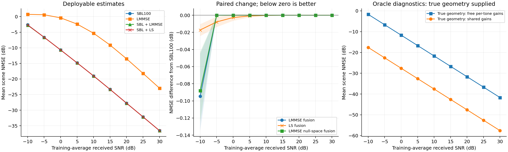

# 固定观测下，SBL与其他先验是否互补

2026-10-23，运行 `prior_complementarity_20261023_v1`。本轮是32个新几何的探索性比较。

**当前证据支持小幅、局部的互补：−10 dB时，验证冻结的SBL＋LMMSE融合比SBL100改善0.095 dB，其中大部分线性误差下降位于观测零空间。但没有建立−5至10 dB的广泛精度增益，也不能把收益归因于额外跨频协方差。** 真实几何已知时的单独诊断表明，严格跨频物理幅相关系有更大的条件降噪潜力；尚未实现未知几何下的对应收益。

用户期望高SNR尽量接近强SBL，约0.1 dB只作期望量级。本轮没有将其写成性能验收条件，也不据单点超出宣布方法有问题。

## 条件及公平比较

沿用父运行 `multirf_snr_20261022_v1` 的300 GHz、30 GHz带宽、4×256单元、4RF、J=32、K=32。每频128个白化复观测估计1024维信道。固定同一DMA状态和热噪声模型，横轴为训练平均接收SNR，−10至30 dB间隔5 dB。相同物理噪声抽样在各SNR共用，通过已知导频功率改变SNR；九点不是九次独立噪声重复。

512个训练几何只用于原训练归一化和LMMSE统计；沿用64个验证几何选择每SNR一个凸融合系数。先冻结源码、输入及全部权重，再生成32个新筛选几何，种子2026102301，与父运行全部划分均不重叠。同一几何的不同SNR成块配对。

全部实际方法共用同一观测、矩阵、噪声及原训练数据的可用范围。两条oracle额外使用真实几何，只列作诊断。主要参照是原DDPM使用的同字典100步SBL，它在此前128几何比较中略优于充分迭代SBL；本轮没有重跑充分迭代版本。100步为固定计算预算，288个输出均未达到原一阶停止阈值，保留全部输出及残差，不称已收敛。

指标为完整CSI的mean scene NMSE：逐场景以真值能量归一化，在线性尺度平均，最后转dB，越低越好；另存物理尺度MSE。配对95%区间用2000次几何重采样，只覆盖固定训练抽样、硬件、噪声生成规则下的新几何波动。

## 方法究竟使用了什么

| 方法 | 已利用 | 当前未显式利用 |
|---|---|---|
| 最小范数LS | 白化观测与矩阵；欠定时取最小范数 | 训练统计、稀疏路径、跨频耦合 |
| 逐频LMMSE | 训练均值、每频空间协方差与已知噪声 | 共同稀疏路径、其他频点观测、严格物理幅相 |
| 原selected LMMSE | 训练均值；0.9逐频块协方差＋0.1样本联合协方差 | 显式路径稀疏、连续角距、严格物理幅相 |
| 当前SBL | 角距字典、各频共同原子方差、已知噪声 | 独立训练得到的均值/协方差、连续离网角距、路径总路程约束的共同幅相 |

SBL已经用全部频点共同决定哪些角距原子有能量；它并非完全不利用跨频信息。当前实现给定共同方差后，仍分别推断每频复系数。共享稀疏倾向与强制同一路径满足总路程相位、吸收及反射幅频关系，是两种不同约束。[源码与原论文逐项核查](../../docs/research/PRIOR_COMPLEMENTARITY_20261023.md)

因此，可以设计方法结合，但不能把两个使用同一观测的后验当独立证据相乘，否则会重复使用似然。本轮采用最简单、可复核的输出融合：

$$
\widehat H=(1-w)\widehat H_{SBL}+w\widehat H_B,\qquad 0\leq w\leq1.
$$

每个SNR的单一$w$只由64个验证几何的mean scene NMSE确定，不按筛选场景或真值调整。权重拟合包含两个估计误差的交叉项，没有误差独立假设。

## 实际融合结果

| 训练平均接收SNR | SBL100 | ＋LS | ＋selected LMMSE | ＋逐频LMMSE |
|---:|---:|---:|---:|---:|
| −10 dB | −2.6481 | −2.6653 | −2.7427 | −2.7422 |
| −5 dB | −6.6254 | −6.6332 | −6.6254 | −6.6254 |
| 0 dB | −10.6878 | −10.6905 | −10.6878 | −10.6878 |
| 5 dB | −14.8235 | −14.8243 | −14.8235 | −14.8235 |
| 10 dB | −19.0177 | −19.0179 | −19.0177 | −19.0177 |
| 20 dB | −27.7493 | −27.7493 | −27.7493 | −27.7493 |
| 30 dB | −36.5563 | −36.5563 | −36.5563 | −36.5563 |

表中为NMSE（dB）；其余SNR与全部方法见[完整汇总](summary.csv)。−10 dB时，单独LS为6.9340 dB、单独selected LMMSE为0.7185 dB，都明显弱于SBL，但少量融合仍有价值。这说明单独误差较大并不排除它提供有用的误差方向。

−10 dB的LMMSE权重为0.12226，融合改善 **0.09467 dB**，配对95%区间为 **[0.04496, 0.13471] dB**，32场景中21个改善。验证集两个估计的聚合误差相关系数为0.549，不能视为独立。相同条件下，LS融合改善0.01725 dB，区间[0.01050, 0.02442]；LMMSE融合相对LS融合的额外改善为0.07742 dB，配对区间[0.03280, 0.11181]。后一个直接比较是对预声明LS对照的补充分析。

从−5 dB开始，两种LMMSE的验证最优凸权重均为0，筛选输出因此与SBL相同。20至30 dB的LS权重也为0；这些重合来自冻结后的选择，不能解释为在所有SNR都获得了融合增益。LS在−5 dB尚有0.00781 dB小改善；0、5、10 dB的改善区间均包含零，实际差异也很小。

## 能否区分收益来自哪里

**未观测方向确实存在可用互补。** 将LMMSE与SBL的差异只投影到矩阵零空间再融合，不改变理想精度下的观测残差。−10 dB仍改善0.08812 dB，区间[0.04276, 0.12442]。另外，直接分解完整LMMSE融合的误差变化，总线性NMSE下降0.011719，其中零空间下降0.010926，约占93.24%。该比例来自同一完整融合的正交分解，不是拿不同最优权重的两条曲线相除。

这支持训练均值和协方差这一组信息可改善当前SBL对未观测方向的补全。它没有区分均值、空间协方差各自贡献，也不说明任意训练分布都有效。

**额外跨频协方差的收益尚未建立。** 用相同512训练CSI，将LMMSE换成完全逐频版本，并固定使用selected版本的融合权重，−10 dB两条融合曲线只差0.00056 dB；selected减逐频的95%区间为[−0.00405, 0.00217] dB。其他SNR权重均为0。因此不能把0.095 dB收益写成“补上跨频二阶相关”。两种版本均包含训练均值及空间统计，这组共同因素尚未进一步拆分。

**LS对照也有小收益。** 这表明普通偏差/收缩调整可能贡献一部分改善。LMMSE融合更好及零空间对照提供了更具体证据，但本轮没有完成所有替代解释的独立消融。

## 严格跨频物理关系的条件潜力

两条诊断均提供相同真实角距和完整路径响应，其中保留总路程相位、自由空间损耗、吸收、反射幅频；区别仅为32频点分别拟合3个复系数，或全部频点共用3个复系数。前者96个复参数，后者3个，二者均从同一观测拟合系数，未直接取真值系数。

| 训练平均接收SNR | 真几何＋逐频自由系数 | 真几何＋全频共同系数 |
|---:|---:|---:|
| −10 dB | −1.6785 | −17.5876 |
| 0 dB | −11.6785 | −27.5876 |
| 30 dB | −41.6785 | −57.5876 |

在已知几何、物理关系准确的条件下，跨频共同系数改善约15.91 dB，配对区间约[14.82, 16.98] dB，32个场景均改善。九个SNR的差距几乎相同，是同一噪声抽样按功率缩放、两种固定线性拟合共同造成的，不能当成九次独立复现。

**这不是未知几何方法的性能，也不是可实现估计器的严格误差下界。** 例如−10 dB时，逐频oracle甚至弱于SBL；SBL还有稀疏收缩，两个模型不同。全频诊断说明该物理约束值得研究，但已知真实几何跳过了最困难的支撑选择、连续距离/角度恢复及相位解模糊问题，15.91 dB不能当作下一算法预期增益。

当前信道固定三路径、已知仰角30°、独立复增益为1且材料响应确定。这使严格物理约束匹配真值；反射系数、材料或路径数发生变化时是否有收益，尚未检验。

## 其他传统方法与下一候选

[T-SBL/T-MSBL](https://arxiv.org/html/1102.3949v2#S2)已经把稀疏性和快拍间相关协方差写入同一模型。因此“稀疏＋相关先验”本身已有先例。其原共同测量矩阵、实数模型与本项目复数、逐频变化矩阵不同，不能直接复制闭式更新。

[P-SIGW](https://oa.ee.tsinghua.edu.cn/dailinglong/publications/paper/Channel%20estimation%20for%20extremely%20large-scale%20MIMO%20Far-field%20or%20near-field.pdf#page=9)已用稀疏估计初始化并连续优化角距及自由逐频增益；DMA的[OG-DOLS](https://arxiv.org/html/2407.04954v1#S4.SS3)也已有共同支撑与离网修正。这些方法可提供几何恢复机制，但所核原文没有直接实现本轮完整路径的全频共同幅相关系。此次未将这些论文算法移植跑分，也未完成穷尽新颖性检索。

下一候选更具体的问题是：**从当前观测取得可用几何，再用真实DMA逐频矩阵与跨频物理路径关系联合拟合，能否保留oracle所提示的部分降噪收益？** 后续若实施，应在同一估计几何下比较自由逐频系数和物理耦合系数，再单独比较连续几何修正，以区分两项改动。这里保留为待讨论方向，不视为已执行或已获新增实验预算。

## 实现核验与归档

运行前的权重极小值、零空间投影、oracle无噪声已知解自检通过。完成后用CPU复双精度独立重放保存的LS、融合、oracle及评分；oracle重放采用正规方程，与运行时伪逆独立比对。指标最大相对差1.25×10⁻¹⁵；训练/验证/旧筛选隔离、源码归档、输入/冻结哈希、观测共享和配对区间复算通过。[核验记录](verification.json) · [实际运行审计](audit.json)

首次启动因服务器持久盘空闲不足2.5 GB，在创建运行前退出，未进行该次计算。改用 `/tmp/dma_ce_probe_runs/<id>/` 内存临时盘后，实际计算约271秒，未超过15分钟。完整运行的本地归档及逐文件核对以[交付清单](delivery_manifest.json)为准；原运行和模型未清理。

配置、源码和冻结选择见[配置](config_resolved.json)、[源码清单](source_manifest.json)、[冻结记录](frozen.json)；[逐场景指标](metrics.csv)、[配对差值](paired_effects.csv)、[补充统计](analysis_summary.json)和[复算脚本](replay.py)保留全部正负结果。实际方法与oracle的标签独立保存。数据范围与运行约定见[指南](../../docs/guides/PRIOR_COMPLEMENTARITY.md)。
