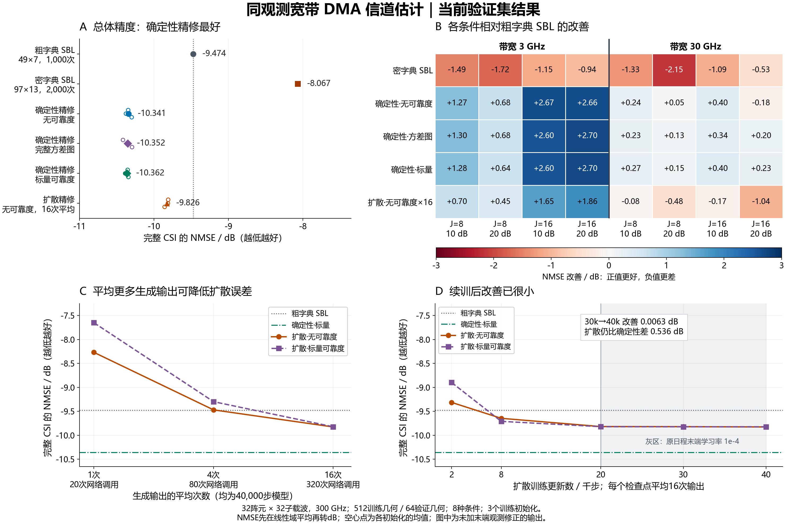

# research_002：当前验证集结果图与实验说明

本图汇总服务器 `/home/lsy/DMA_CE/results/research_002` 已完成的验证结果。最好的总体方案是带标量可靠度的确定性残差精修，NMSE为−10.36174 dB，比粗字典SBL改善0.88810 dB。当前最佳扩散平均16次后为−9.82596 dB，仍比该确定性方案差0.53578 dB。

[矢量PDF](validation_overview.pdf) · [矢量SVG](validation_overview.svg) · [总体数据](overall_results.csv) · [分条件数据](condition_results.csv)

## 场景与配置

| 项目 | 本轮实际设置 |
|---|---|
| 信道与阵列 | 300 GHz载频，单用户，单微带DMA，1条接收RF链；32个阵元、32个OFDM子载波，阵元间距为半波长 |
| 传播场景 | 3条球面波路径；每条路径的距离在0.1–0.4 m、角度在−60°到60°内连续随机生成；本轮不含大气吸收 |
| 带宽 | 3 GHz、30 GHz，分别为载频的1%、10% |
| 导频观测 | 每个子载波使用8或16个已知DMA配置，将32维阵元信道压缩为8或16个复数观测 |
| 硬件响应 | 频率相关Lorentzian单元响应和馈线传播/损耗；同一物理调谐状态跨子载波共享。品质因数50，调谐范围30 GHz |
| SNR | 白化后的训练集平均接收SNR为10或20 dB；带宽×配置数×SNR共8种条件 |
| 数据与重复 | 512个训练几何，64个独立验证几何；同一几何用于全部8种条件。网络使用101、102、103三个初始化种子 |
| 确定性网络 | 跨阵元与频率的3×3卷积，宽度32，15,428个参数；Adam，批量32，20,000次更新 |
| 扩散网络 | 同一CNN结构、粗估和条件损失，VP扩散100个训练时间步，DDIM每次生成20步；比较2k/8k/20k/30k/40k训练检查点及1/4/16次输出平均 |
| 学习率 | 原20k步余弦日程由0.001降至0.0001；追加训练保持0.0001，模型、优化器和随机状态连续恢复 |

各方法在同一条件下使用完全相同的DMA观测、噪声实现和已知硬件矩阵。神经网络额外使用训练集信道标签学习残差；估计时不输入真实路径参数。训练、验证按几何独立划分，归一化、可靠度标定和条件损失权重来自训练集。

这里的“可靠度”是SBL近似后验给出的方差，经训练集标定和对数标准化后作为输入。“完整方差图”保留每个阵元、子载波的方差；“标量可靠度”先对同一样本全部分量的方差取平均，再广播回输入尺寸；“无可靠度”使用零占位，网络参数量相同。

## 方法与总体效果

SBL指稀疏贝叶斯学习：在预设角度、距离字典上估计系数，再重建完整信道。确定性精修用一次CNN前向运算预测粗估残差，并与SBL粗估相加。扩散精修从不同初始噪声生成条件残差；多次生成在复数信道上取算术平均。

| 方法 | 具体设置 | 总体NMSE/dB | 相对粗字典SBL改善/dB |
|---|---|---:|---:|
| 粗字典SBL | 49个角度×7个距离，343个原子；1,000次迭代上限 | −9.47364 | 0 |
| 密字典SBL | 97个角度×13个距离，1,261个原子；2,000次迭代上限 | −8.06728 | −1.40636 |
| 确定性，无可靠度 | 同观测粗估+零可靠度占位；20k步 | −10.34060 | +0.86697 |
| 确定性，完整方差图 | 同观测粗估+逐分量后验方差；20k步 | −10.35242 | +0.87878 |
| 确定性，标量可靠度 | 同观测粗估+样本平均后验方差；20k步 | **−10.36174** | **+0.88810** |
| 当前最佳扩散 | 无可靠度，40k步，平均16次生成 | −9.82596 | +0.35232 |

NMSE衡量完整32×32信道的归一化平方误差，数值越低越好。总体数值先对每条记录的线性NMSE求均值，再取10倍常用对数。神经网络每个方法汇总3个种子×64个几何×8个条件；这仍是64个独立验证几何。图A的小空心点是每个训练初始化的均值，不是置信区间。

本图比较的是末端观测一致性修正前的输出。粗、密字典各自在相同验证观测上选择迭代预算，并通过既定收敛率及均值/方差稳定性检查。密字典在本轮8种条件下全部弱于粗字典。

## 分条件与消融结果

图B中蓝色、正值表示比粗字典SBL更好；红色、负值表示更差。`J`为DMA配置数，10/20 dB为本条件的平均接收SNR。

- 标量可靠度确定性精修在8种条件下均优于粗字典SBL。3 GHz下改善0.637–2.696 dB；30 GHz下改善0.147–0.404 dB。
- 当前最佳扩散在3 GHz下改善0.447–1.859 dB；在30 GHz下的4种条件均变差，退化0.083–1.035 dB。
- 可靠度带来的总体额外收益较小：确定性标量版本比无可靠度版本改善0.02114 dB。在30 GHz、J=16、SNR=20 dB这一条件下，改善为0.41179 dB；它将无可靠度精修的退化改为相对SBL改善0.23402 dB。
- 固定无可靠度40k扩散模型，1/4/16次平均的NMSE分别为−8.26979/−9.46948/−9.82596 dB。每次生成调用网络20次，对应20/80/320次网络调用；确定性精修调用1次。所有方案另有共同的SBL粗估计算。
- 无可靠度扩散从20k续训到40k只改善0.00841 dB，30k到40k改善0.00628 dB，低于原定0.1 dB稳定性阈值。图D显示两种扩散可靠度版本在16次平均时的总体均值已很接近。

## 数据与复现

逐场景源表保存在服务器原结果目录，以及本机 `runs/research_002_overview_20261019_v1/source_tables/`。绘图检查了512组“条件×几何”观测哈希的跨方法一致性，检查各分组的64个几何和三个训练种子完整，并从CSV重算所有30个扩散候选的汇总NMSE，核对原冻结选择值。

- [完整种子×条件汇总](all_method_seed_context_means.csv)保留源表中的全部字典预算、可靠度置换和扩散候选。
- [源表哈希](source_data_manifest.json)、[图形来源与导出记录](figure_provenance.json)、[原验证审计](validation_audit.json)绑定数据、处理方式和输出。
- [完整配置](config_resolved.json)、[训练环境](training_environment.json)和[图形核对记录](figure_audit.json)保存本轮设置及导出检查。
- [绘图代码](plot_results.py)可在仓库目录执行：`python results/research_002_overview_20261019_v1/plot_results.py`。服务器已有原始表时可将 `/home/lsy/DMA_CE/results/research_002` 作为唯一位置参数。

以上是用于模型选择的验证集结果。独立筛选几何、5个新初始化及128阵元扩展结果由最终阶段另行生成。
