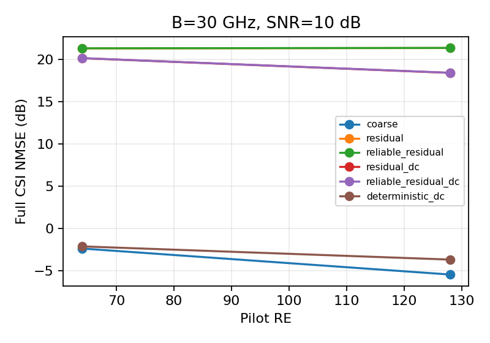
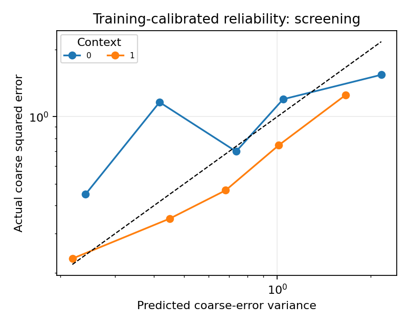

# 首轮条件生成实验

## Material Passport

- Origin Skill: ARS-Codex experiment-agent
- Origin Mode: run
- Origin Date: 2026-10-16
- Verification Status: ANALYZED
- Version Label: pilot_v1

状态：完成。标签：smoke_connectivity_only。
独立筛选几何8个，条件2组，逐场景指标176行。
同一几何的条件按块配对；区间仅描述该单训练种子下的几何差异。

| 对照 | 配对平均差/dB | 描述性95%区间/dB |
|---|---:|---|
| reliable_residual − residual | 0.0122 | [0.0099, 0.0144] |
| reliable_residual_dc − residual_dc | 0.0118 | [0.0078, 0.0153] |
| reliable_residual_shuffled − reliable_residual | 0.0001 | [-0.0024, 0.0025] |
| reliable_residual_shuffled_dc − reliable_residual_dc | -0.0004 | [-0.0033, 0.0027] |
| deterministic_dc − reliable_residual_dc | -21.0527 | [-22.6866, -19.6030] |

负值表示左侧方法更好。此表均值是逐场景dB配对差，不等于线性均值再转dB之差。

SBL非收敛比例见summary.csv，逐场景迭代/残差见metrics.csv。后验对角是模型内代理，图中实测误差只用于评分。
计算时间为批量均摊，不是单样本在线时延；该缩小系统不支持完整尺寸或通信净速率结论。
