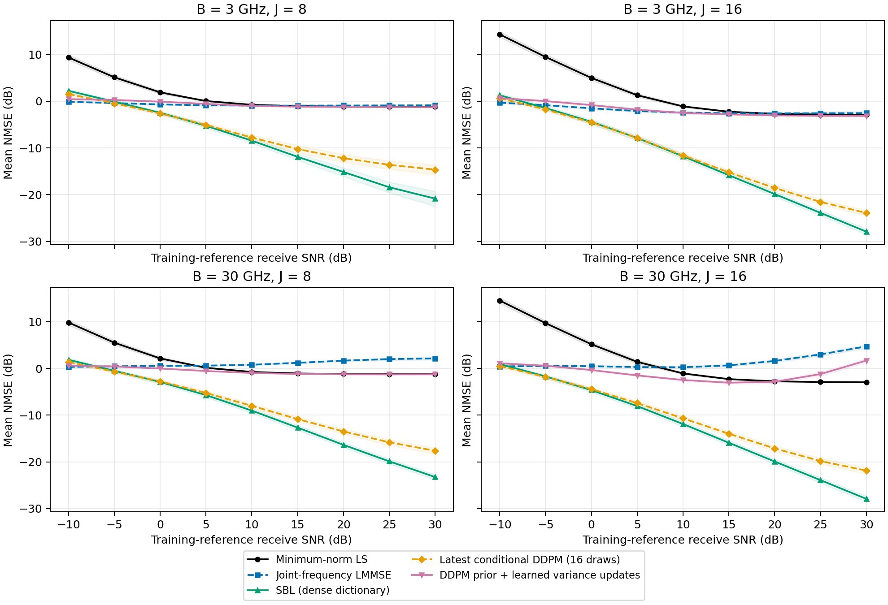

# −10至30 dB信道估计比较：结果与机制检查

## Material Passport

- Origin Skill: academic-research-suite / experiment-agent
- Origin Mode: run / validate
- Origin Date: 2026-10-20
- Verification Status: VERIFIED
- Version Label: snr_comparison_20261020_v1

## 实际结论

当前三轮“完整CSI DDPM先验＋学习方差更新”在中高SNR明显弱于密字典SBL及最新条件DDPM。它相对LMMSE初始化有改善，学习方差相对固定方差的额外改善较小，并在低SNR出现退化。

新方案均值优于最新条件DDPM的条件为2/36，优于密字典SBL为3/36，优于固定更新为24/36。各条件和点区间完整保留，未根据筛选结果调整模型。

## 五方法实际曲线

32阵元、32频点、单RF链；3/30 GHz，8/16次DMA配置；角度±60°，距离0.1–0.4 m。128个新筛选几何、3个训练初始化。SNR每5 dB一个实际点。各方法共享观测、噪声和训练统计来源。

以下在每个SNR合并四种硬件条件，先平均线性NMSE，再转dB；具体条件见上图。SNR按训练集平均白化接收功率定义，逐场景实际SNR另存。

| SNR/dB | 最小范数LS | 联合LMMSE | 密字典SBL | 最新条件DDPM | DDPM＋学习更新 |
|---:|---:|---:|---:|---:|---:|
| -10 | 12.642 | 0.090 | 1.602 | 1.035 | 0.712 |
| -5 | 7.953 | -0.019 | -0.896 | -1.133 | 0.328 |
| 0 | 3.812 | -0.213 | -3.503 | -3.494 | -0.311 |
| 5 | 0.764 | -0.395 | -6.546 | -6.226 | -1.072 |
| 10 | -0.922 | -0.413 | -10.009 | -9.213 | -1.677 |
| 15 | -1.628 | -0.177 | -13.707 | -12.092 | -1.965 |
| 20 | -1.877 | 0.287 | -17.319 | -14.609 | -2.015 |
| 25 | -1.959 | 0.922 | -20.861 | -16.622 | -1.652 |
| 30 | -1.986 | 1.746 | -23.927 | -18.090 | -0.643 |

−10 dB合并均值以LMMSE最低；从5 dB开始，五条主曲线中密字典SBL的合并均值最低。方法排序随SNR变化。全部九个SNR混合的均值见[原始执行报告](report.md)。

## 输入输出与训练方式

从系统接口看，两条路线都把观测及已知配置映射为完整CSI。旧条件DDPM先用SBL100粗估，再生成条件残差；新方案训练完整干净CSI的DDPM，冻结后再训练方差更新网络。新网络只改变正方差，复均值由真实DMA矩阵的高斯条件式计算，三轮共享权重。

新推理流程为：观测、DMA矩阵和噪声方差 → 训练统计LMMSE初始化 → DDPM去噪 → 学习正方差 → 解析观测更新，重复三轮后输出CSI。训练标签为真实CSI。

CSI先验14,996参数，方差网络3,201参数；每次恢复调用三次DDPM和三次方差网络。最新条件DDPM为父运行已冻结版本，20步采样、16次平均，共320次去噪网络调用。固定更新与学习更新使用同一先验、初始化、轮数和验证选择的强度。

CSI先验从512个训练几何的两带宽信道学习；新方差网络带噪训练使用10/20 dB，其他SNR是冻结权重迁移。验证集64个几何，用于选择断点及全局强度；新筛选几何在冻结之后生成。三次先验均选20,000步，方差网络均选1,000步，统一强度均选10。

Li等TCOM2026采用Bayesian学习展开与注意力方差更新，其方法不使用DDPM。本次组合借鉴其解析计算与学习更新的分工；DDPM信道先验参考Zhou等的工作。原文：[Li等](https://doi.org/10.1109/TCOMM.2026.3675428) · [Zhou等](https://arxiv.org/abs/2408.10501)。

## 固定更新与学习更新消融

[消融图](snr_nmse_ablation.png)同时保留固定更新、单次/十六次条件DDPM和确定性精修。

20 dB时，固定更新合并NMSE为−1.935 dB，学习更新为−2.015 dB，额外改善0.080 dB；−10 dB时，固定更新为0.187 dB，学习更新为0.712 dB，反而高0.526 dB。全九个SNR混合均值分别为−0.891与−0.815 dB，低SNR退化抵消了其他点的小幅改善。

20 dB时，旧DDPM的SBL100初估为−14.440 dB，最终为−14.609 dB；新方案的LMMSE初始化为0.287 dB，最终为−2.015 dB。两条管线的起点相差很大。新方案对自身初始化改善约2.302 dB，最终误差仍高于旧方法。

## 差距来源的实际检查

事后诊断使用64个训练和64个验证几何，冻结模型与超参数，不改变主曲线。完整数据与控制变量见[分步诊断](../snr_comparison_20261020_v1_diagnostic_v2/report.md)。

1. **初始化误差与扩散噪声结构不同。** 3 GHz、20 dB验证输入的NMSE为−1.740 dB。同一DDPM、同一扩散时间，对实际LMMSE输入去噪后为−1.326 dB；仅把误差改成每场景等能量的随机方向，去噪后为−5.049 dB。误差大小保持相同，去噪行为仍不同。

2. **当前方差没有匹配真实初始化误差。** 30 GHz、30 dB验证输入的实际MSE约为统计对角方差的12.5倍；3 GHz、20 dB约为1.4倍。扩散时间在方差网络之前按统一规则选取，后面的方差学习不能在当轮去噪前修正时间选择。

3. **观测更新后仍有大量不可直接观测误差。** 3 GHz、20 dB验证例中，首次高斯更新把观测残差从0.394降到约0.000011，但零空间误差从0.621变为0.624；三轮学习更新后，零空间误差仍占完整误差约97.3%。

4. **联合协方差估计是另一项可区分因素。** 同样512个训练几何，30 GHz、30 dB验证下，1024维联合LMMSE为3.407 dB，32维逐频LMMSE为−2.191 dB。该对照改变了协方差估计维数与跨频项；尚未单独分离样本数和正则化的贡献。逐频LMMSE为事后诊断，主曲线保留原定联合LMMSE。

## 核验与研究范围

服务器耗时4525.266秒。101,376条指标从保存预测重算，最大差0；4次主流程结构化恢复重放最大差0。密字典SBL的4,608个几何×条件输出全部满足1e−3一阶阈值，最多18,174次更新。18个服务器导出文件逐字节哈希一致，两张图已目视核对。

128个新筛选CSI哈希与512个训练、64个验证及旧运行128个筛选均无重叠。冻结参数、源代码压缩包、环境与父运行哈希均归档。分步诊断另有192次恢复末端核验，最大差0。

父运行research_003已独立核验：143,360条指标、4次采样重放最大差0；五初始化的匹配均值为密SBL−11.704 dB、确定性−11.560 dB、DDPM16−10.627 dB。见[父运行重审](../research_003_review_20261020_v1/report.md)。

曲线区间按几何块bootstrap，先平均初始化；区间不包含初始化变动。180个配对区间均为逐比较区间，未作多重比较校正，作为探索性描述。DMA矩阵沿用训练配置，本轮覆盖SNR迁移及新几何。完整尺寸、新DMA矩阵和范围外几何属于后续验证。

下一项区分实验可固定DDPM、观测、初始化及迭代数，只替换训练集标定的扩散时间规则；另固定其余处理，只把更新网络的训练SNR从10/20改成全九点，总训练步数保持不变。分别观察完整NMSE和零空间误差，可区分时间选择与带噪训练覆盖的影响。

[逐场景数据](metrics.csv) · [逐条件汇总](summary.csv) · [每SNR合并值](pooled_snr_summary.csv) · [配对区间](paired_effects.csv) · [执行核验](execution_verification.json) · [独立性检查](independence_audit.json)

统计解释检查覆盖11/11项，详见[统计核验记录](statistical_review.json)。
