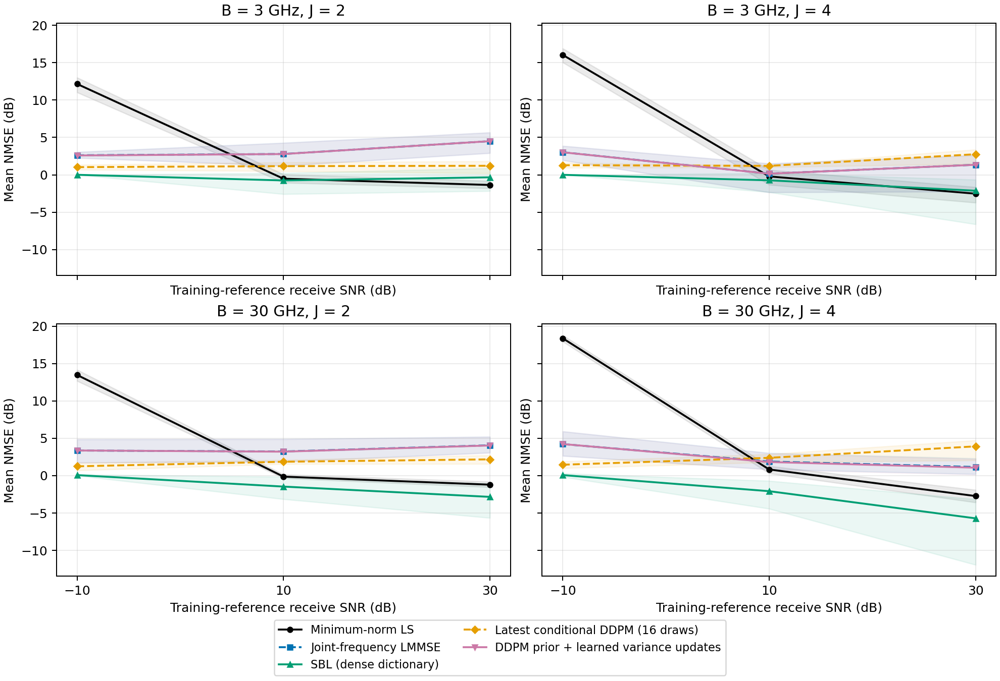
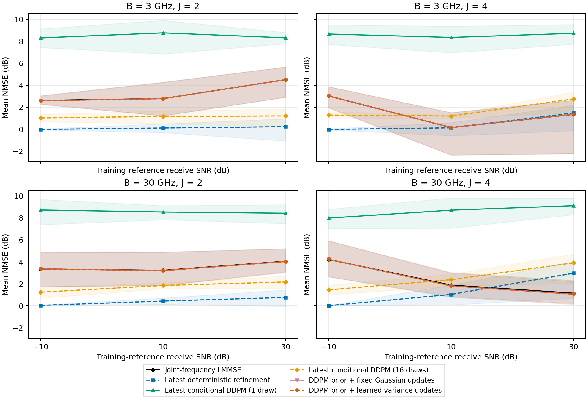

# DMA信道估计：SNR扫描与DDPM先验结构化更新

运行：`snr_comparison_smoke_20261020_v1`。父运行：`corrected_sbl_smoke_20261020_v1`。

这是在既有实验结果基础上设计的新探索性比较。所有方法共享每个场景的真实DMA观测和噪声。
系统：8阵元、8频点、单RF链；角度±60.0°、距离0.005–0.02 m。
SNR点：[-10, 10, 30] dB；独立筛选几何4个；学习方法初始化[201]。
SNR按训练集在白化观测域中的平均接收功率定义；逐场景实际SNR也保存在原始CSV。

## 方法与信息条件

- LS使用逐频Moore–Penrose最小范数解。
- LMMSE使用训练几何估计完整阵元—频率联合均值和协方差，保留跨频统计。
- 主SBL采用密字典，最多10次更新，按标准化一阶条件0.001停止；逐场景实际次数和非收敛完整保存。
- 最新DDPM为父运行已冻结的条件残差模型；主图使用16次平均，辅助图保留单次输出。其SBL初始化与训练时预算一致。
- 新DDPM直接学习完整干净信道分布；冻结后以LMMSE初始化，交替DDPM去噪与真实逐频DMA的高斯观测更新。
- 学习更新版本只预测正的阵元—频率先验方差，复均值仍由解析条件式计算。固定更新消融使用同一先验、初始化、迭代数及验证选择的全局强度。
- DDPM参数、更新网络及超参数只从训练/验证数据获得；新筛选几何在冻结记录写出后生成。
- 旧条件模型和新更新网络的带噪训练仍使用父运行的SNR配置；其余SNR检验冻结权重的迁移。DDPM先验训练的人工扩散噪声不等同于导频SNR。
- 该交替算法是plug-and-play近似；内部对角方差未标定为真实后验误差。Li等TCOM2026提供学习先验方差更新的启发，其原文不使用DDPM。

## 曲线

每个标记对应实际运行点，相邻线段仅用于连接。NMSE先逐场景归一化、在线性尺度平均，再转dB。
阴影为95%几何场景bootstrap区间；先平均各训练初始化，再按几何块重采样，包含所有配对SNR/硬件条件。阴影不包括训练初始化不确定性。

## 全部条件平均

| 方法 | NMSE/dB |
|---|---:|
| Minimum-norm LS | 11.0943 |
| Joint-frequency LMMSE | 2.8761 |
| SBL (dense dictionary) | -1.0688 |
| SBL (100 updates) | 0.7140 |
| Latest conditional DDPM (1 draw) | 8.5599 |
| Latest conditional DDPM (4 draws) | 4.3699 |
| Latest conditional DDPM (16 draws) | 1.8949 |
| Latest deterministic refinement | 0.6955 |
| DDPM prior + fixed Gaussian updates | 2.8594 |
| DDPM prior + learned variance updates | 2.8596 |

密字典SBL有12个条件的一阶条件通过率低于90%；各点通过率见summary.csv。
审计重算480条指标，最大差0.0；4次结构化恢复重放最大差0.0。

[逐场景数据](metrics.csv) · [汇总与区间](summary.csv) · [配对差异](paired_effects.csv) · [冻结参数](frozen.json) · [审计](audit.json)

在线时间包含初始化与恢复的批量均摊应用时间，已知矩阵预计算、训练和预热另行排除；它不等于单样本时延。
当与固定更新、LMMSE或密字典SBL相比没有改善时，保留原始结果，不用观测残差下降替代完整CSI改善。

本运行仅为缩小预算的实现验证，其性能数值不作为方法结论。
