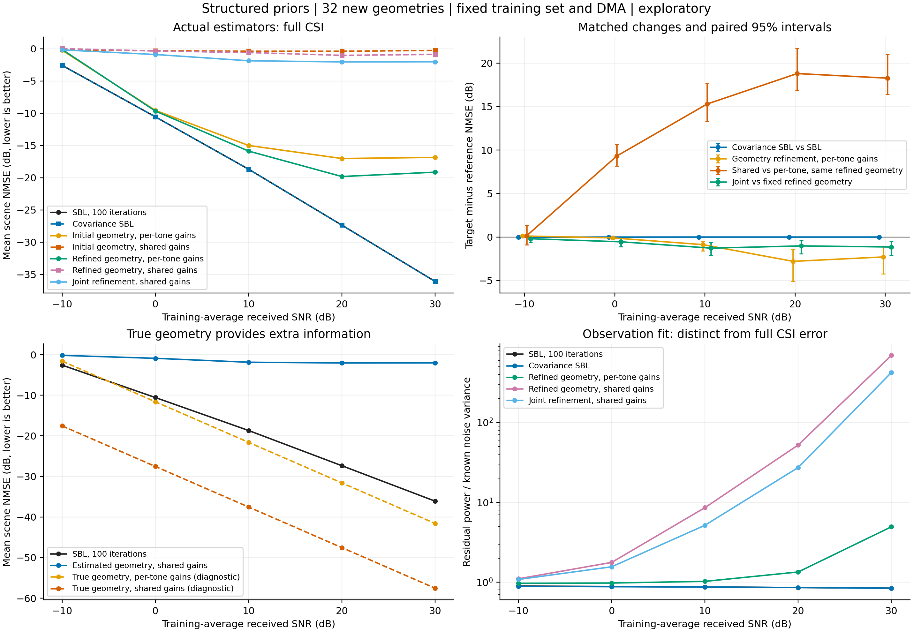

# 模型内协方差与未知几何物理恢复

2026-10-23，运行 `structured_prior_20261023_v1`，计算599.26秒。32个新独立几何、五个SNR的无网络探索已完成，正负结果均保留。

**模型内协方差只带来很小的低SNR正收益；本轮未知几何物理恢复明显弱于SBL。匹配对照和事后真值投影表明，当前估计几何限制了可表达的信道，直接施加共同路径系数会放大这种失配。** 这支持否定本轮这套单初值局部恢复器的精度优势，尚不能否定所有物理联合恢复或学习SBL。

## 条件与方法

固定300 GHz载频、30 GHz带宽、4×256单元、4RF、32个DMA状态及32频点，每频128个白化复观测恢复1024维CSI。横轴为训练平均接收SNR，五点为−10、0、10、20、30 dB；同一几何各SNR共用物理噪声抽样，依已知导频功率改变归一化噪声，因此五点不是五次独立重复。

沿用父运行 `multirf_snr_20261022_v1` 的512训练几何、归一化、硬件及功率校准；使用原验证集前32几何选参，先冻结再生成32个新筛选几何，种子2026102302。新几何与训练、验证、原128筛选和上一轮32筛选均无交集。全部实际方法共用相同观测、噪声和DMA矩阵。三路径、已知仰角和材料沿用公开模型约定；真实几何只进入明确标记的诊断。

- **SBL100**：原角距字典、共享原子方差，固定100步。
- **协方差SBL**：在同一观测似然内使用 $C_{h,k}=D_k\Gamma D_k^H+\eta R_k$。$R_k$由512训练CSI中心化估计；增广后验包含稀疏项及统计项，只更新稀疏方差。这里加入的是逐频训练空间协方差，没有新增跨频非对角块或非零先验均值。与原SBL同为100步，$\eta\in\{0,0.01,0.1,1\}$仅由验证集选择。
- **物理恢复**：同观测SBL选三个经相干度抑制的峰，最强候选作为LoS假设，不用真值重启。初始几何及逐频系数修正后的几何各比较逐频自由系数和全频共同系数。几何修正固定60步Adam；随后共同系数下联合修正80步。两种系数模型使用同一完整传播列、DMA矩阵及相对ridge $10^{-8}$。每个场景只按自身观测残差保留预算内最佳几何。

完整设计、步长及边界见[指南](../../docs/guides/STRUCTURED_PRIOR_PROBE.md)与[冻结记录](frozen.json)。SBL与协方差SBL均为固定预算，不称已收敛：各自160个方法输出全部未到原一阶阈值，10 dB及以上两方法输出相同。实际残差见[求解诊断](solver_diagnostics.json)。本轮没有重跑充分迭代SBL或训练网络。

指标为完整CSI的mean scene NMSE：逐场景除以真值能量，在线性尺度平均后转dB，越低越好。配对95%区间按独立几何做2000次重采样，只覆盖固定训练抽样和硬件下的新几何波动。高SNR约0.1 dB仍为用户期望量级，未设性能判败门槛。

## 实际精度

下表为主要实际输出，单位dB。全部七条实际曲线及两条真几何诊断见[完整汇总](summary.csv)，逐场景数据见[metrics.csv](metrics.csv)。

| 训练平均接收SNR | SBL100 | 协方差SBL | 修正几何、逐频系数 | 联合修正、共同系数 |
|---:|---:|---:|---:|---:|
| −10 | −2.5692 | −2.5847 | −0.1098 | −0.1690 |
| 0 | −10.5561 | −10.5599 | −9.6559 | −0.8908 |
| 10 | −18.6810 | −18.6810 | −15.8726 | −1.8588 |
| 20 | −27.3575 | −27.3575 | −19.8185 | −2.0407 |
| 30 | −36.0933 | −36.0933 | −19.1430 | −2.0174 |

## 协方差有小幅正证据，尚未形成较大收益

| SNR | 验证冻结的 $\eta$ | 相对SBL的改善/dB | 改善量配对95%区间/dB | 改善场景 |
|---:|---:|---:|---:|---:|
| −10 | 0.1 | 0.01556 | [0.01095, 0.02014] | 28/32 |
| 0 | 0.01 | 0.00377 | [0.00162, 0.00593] | 22/32 |
| 10、20、30 | 0 | 0，输出完全相同 | [0, 0] | 0/32 |

低SNR两点分别约在线性平均误差上再减少0.358%和0.087%。这种收益在本轮新几何配对中方向稳定，但幅度很小；高SNR重合来自验证选择零统计项，不能解释成非零协方差在高SNR仍有新增收益。[验证候选](validation.csv) · [配对区间](paired_effects.csv)

这说明所检验的训练协方差相加模型能够提供少量补充，没有建立覆盖低中SNR的较大收益。它不代表非对角跨频相关、残差统计或学习方差更新都无价值。本轮与前轮输出融合使用不同新筛选几何，验证数也由64变32，不能将0.0156与前轮0.0947 dB直接当作两种融合形式的公平优劣排序。

## 几何修正与共同系数必须分别判断

下表为目标减参照的NMSE差值，负数表示改善；三个比较分别只改变所标注的因素，区间保留在[配对结果](paired_effects.csv)。

| SNR | 逐频系数下：修正减初始几何 | 同一修正几何：共同减逐频系数 | 共同系数下：联合修正减固定修正几何 |
|---:|---:|---:|---:|
| −10 | +0.120 | +0.134 | −0.193 |
| 0 | −0.098 | +9.313 | −0.548 |
| 10 | −0.872 | +15.288 | −1.274 |
| 20 | −2.794 | +18.797 | −1.019 |
| 30 | −2.290 | +18.269 | −1.143 |

**连续修正有局部作用，但未超过SBL。** 20和30 dB相对各自初始三峰几何改善2.794和2.290 dB，区间分别为[1.408, 5.104]和[1.054, 4.230] dB，两点均为32/32场景改善。然而30 dB修正后的−19.143 dB仍明显弱于SBL的−36.093 dB，不能把相对较差初值的改善称为胜过SBL。

**低SNR的更小观测残差还可能伴随更差信道。** −10 dB下，逐频几何修正让32/32场景观测残差下降，其中24个完整CSI变差；平均NMSE退化0.120 dB，区间[0.0359, 0.2133]。这支持当前按观测残差做局部几何拟合在强噪声下存在精度代价，没有单独证明全部代价来自哪一条路径或哪种优化误差。[逐场景拟合诊断](fit_diagnostics.csv)

**共同物理系数对错误几何很敏感。** 在同一修正几何下，0 dB及以上四点的32个场景全部因改为共同系数而变差。30 dB退化18.269 dB，区间[16.438, 21.026]。共同系数下进一步调整几何虽改善1.143 dB，仍停在−2.017 dB；其平均观测残差也是噪声功率的422倍。因此当前输出既未达到精度目标，也未把物理观测解释到噪声水平。

## 真几何对照与固定几何表达误差

同一新几何的两条真几何诊断仍显示约15.947 dB的共同系数条件收益；30 dB分别为逐频−41.594、共同−57.541 dB。两条都额外读取相同真几何，再从同一观测拟合系数。这表明完整传播约束在几何准确时有降噪潜力，不能把它当作未知几何算法已获得的增益或一般误差下界。

为区分固定几何的表示能力与系数拟合，运行结束后增加一个明确使用真值的只读诊断：固定实际恢复器在30 dB给出的每套几何，用完整真实CSI直接做无正则最小二乘投影。它求这套固定几何和系数族所能表达的最小完整CSI误差，不向恢复器或验证选择反馈信息。

| 冻结的实际几何 | 完整真值投影：逐频系数/dB | 完整真值投影：共同系数/dB | 原观测拟合的共同系数/dB |
|---|---:|---:|---:|
| SBL三峰初值 | −16.985 | −0.264 | −0.257 |
| 逐频系数下修正后 | −19.277 | −0.884 | −0.874 |
| 共同系数下联合修正后 | −16.628 | −2.025 | −2.017 |

即使把完整真值交给系数拟合，当前联合修正几何的共同系数也只能达到约−2.025 dB，几乎等于实际−2.017 dB。这把本轮30 dB的主要限制定位到**这套估计几何对应的可表达信道空间**，而非最后三维系数线性求解不够精确；它不是对其他几何或其他恢复器的下界。[诊断定义、原始数值](geometry_diagnostic.json) · [诊断源码](geometry_diagnostic.py)

声明为LoS的候选距离与真LoS距离的绝对差中位数，由初值8.74 cm降至逐频修正后的2.40 cm。这个厘米量级在宽带共同相位中仍不可忽略：直达路径距离误差 $\Delta r$ 在两频之间产生 $2\pi\Delta f\Delta r/c$ 的相位差误差；逐频自由系数可以吸收这部分频变相位，共同系数无法这样补偿。不过LoS标签、反射点选择、局部初值和时延混叠仍未被单因素对照分开，不能把全部退化归因于这一距离统计。

## 实现证据、归档与后续问题

运行前检查覆盖零统计项复现原SBL、独立复高斯后验、证据下降、Torch/NumPy传播一致性、几何梯度、已知无噪声系数恢复和局部修正。86项完整检查及完整尺寸短流程通过；规格审查发现重合反射点边界与原物理模型不一致，修正后受影响10项检查通过。[实现记录](implementation_checks.json)

保存结果用独立路径复算：1440条完整CSI、物理尺度及行/零空间指标最大相对差为 $2.35\times10^{-15}$；用原NumPy传播模型及增广最小二乘重放所有物理拟合，预测最大相对平方差为 $7.73\times10^{-16}$。验证选择、配对区间、几何隔离、冻结顺序及源码/输入哈希均核对通过。优化器没有重新运行；这些证据确认已保存实现和评分一致，不能替代多次科学重复。[verification.json](verification.json)

完整配置、环境、源码、训练输入、验证候选、冻结记录、观测、预测和优化状态归档于本地 `runs/structured_prior_20261023_v1/`；完整尺寸短流程在 `runs/structured_prior_checks_20261023_v1/`。复制与逐文件哈希核对见[交付记录](delivery_verification.json)。本结果目录含必要的小型证据、图表和复算脚本，不提交缓存、模型或原PDF。

本轮结果不支持直接扩大当前物理恢复器或把新增网络视为已确定方案。若继续物理路线，下一项有价值的区分是路径/LoS假设与搜索初值：保持共同系数模型和观测不变，分别检查LoS候选或多个可观测几何/时延起点能否降低表示误差，再决定是否学习初始化或更新。这里是待讨论方向，未启动新实验。协方差分支保留为小幅正证据，尚不足以单独支撑主要精度路线。

本轮限于固定训练抽样、单DMA状态组、32个新几何、五SNR和当前三路径局部恢复器；没有多种子、硬件变化或网络训练结果。
